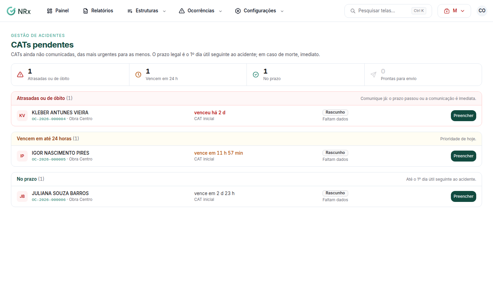

# Acompanhar as CATs pendentes

**Para que serve:** ver as CATs ainda não comunicadas, das mais urgentes para as menos, e o que falta em cada uma.


**Quem pode fazer:** Gestor ou Administrador, com a permissão de preencher a CAT. CATs com dados de saúde só abrem para quem tem a permissão de ver dados de saúde do acidentado.


## Antes de começar

* A CAT é aberta sozinha quando a ocorrência tem um colaborador marcado como acidentado.

## Passo a passo



### Abra as CATs

Clique em **Ocorrências › CATs**. Abre **CATs pendentes**, em grupos: **Atrasadas ou de óbito**, **Vencem em até 24 horas** e **No prazo**.

<figure><figcaption>
CATs pendentes
</figcaption></figure>



### Veja a situação

Cada CAT mostra se **Faltam dados**, está **Completa, falta enviar**, **Aguardando o eSocial** ou se **O eSocial recusou**. Clique na CAT para abrir.



## Dúvidas comuns

Qual o prazo legal?

O 1º dia útil seguinte ao acidente. Em caso de morte, a comunicação é imediata.

Apareceu "Nenhuma CAT pendente".

Todas as comunicações estão em dia.

