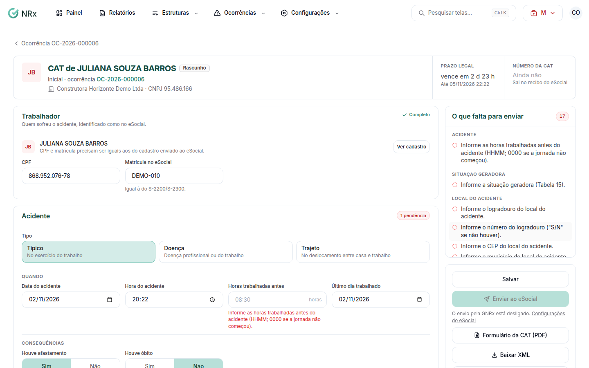

# Preencher e enviar a CAT

**Para que serve:** completar a Comunicação de Acidente de Trabalho e enviá-la ao eSocial.


**Quem pode fazer:** Gestor ou Administrador, com a permissão de preencher a CAT. Para enviar: a permissão de assinar e transmitir a CAT ao eSocial.



Os dados do atestado médico são sigilosos: só quem pode ver dados de saúde abre esta CAT.


## Antes de começar

* O eSocial precisa estar configurado em **Configurações › eSocial**.

## Passo a passo



### Abra a CAT

Clique em **Ocorrências › CATs** e abra a CAT. O topo mostra o **Prazo legal** e **O que falta para enviar**.

<figure><figcaption>
CAT
</figcaption></figure>



### Preencha

Complete os dados do acidentado, do acidente (data, hora, local, **Situação geradora**, **Agente causador**), da lesão (**Parte do corpo atingida**, **Natureza da lesão**) e do **Atestado médico**. Clique em **Salvar**.



### Envie

Quando não faltar nada, clique em **Enviar ao eSocial**. O **Número da CAT** sai no recibo do eSocial.



## Deu errado?

| Situação | O que fazer |
| --- | --- |
| **O eSocial recusou** | Abra a CAT, veja o motivo nos envios e corrija. |
| "O eSocial não encontrou um cadastro" | Use **Preparar o ambiente de testes** ou confira o cadastro do empregador. |
| Enviou por outro sistema | Clique em **Informar número da CAT**. |

## Dúvidas comuns

Preciso corrigir uma CAT já aceita.

Faça a retificação: ajuste, clique em **Salvar retificação** e em **Enviar retificação**. Para desistir, clique em **Descartar retificação**.

O acidentado morreu depois da CAT.

Use **Comunicar óbito**.

Preciso do formulário impresso.

Clique em **Formulário da CAT (PDF)**.

