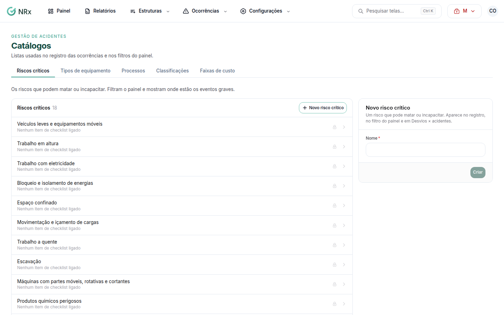

# Ajustar os catálogos

**Para que serve:** cadastrar os riscos críticos, os tipos de equipamento, os processos, as classificações e as faixas de custo da empresa.


**Quem pode fazer:** Gestor ou Administrador, com a permissão de editar as configurações do módulo.


## Antes de começar

* Os itens de origem **Sistema** já cobrem os casos mais comuns. Crie só o que é próprio da empresa.

## Passo a passo



### Abra os catálogos

Clique em **Configurações › Catálogos**.

<figure><figcaption>
Catálogos
</figcaption></figure>



### Cadastre o que precisa

* **Riscos críticos** (**Novo risco crítico**): os riscos que podem matar ou incapacitar.
* **Tipos de equipamento** (**Novo tipo de equipamento**): a identificação (placa, TAG) vai na ocorrência.
* **Processos** (**Novo processo**): as atividades da operação, como carregamento.
* **Classificações** (**Nova classificação**): a gravidade de cada caso. Diga se **Conta como caso registrável (TRIFR)**.
* **Faixas de custo** (**Nova faixa**): os limites crescem de uma faixa para a outra.



### Salve

Preencha e salve.



## Deu errado?

| Mensagem na tela | O que fazer |
| --- | --- |
| "Os limites precisam crescer de uma faixa para a outra." | Ajuste os limites. |
| "Só a última faixa fica sem limite." | Dê limite às outras faixas. |
| "Dê um nome a cada faixa." | Preencha os nomes. |

## Dúvidas comuns

Como tiro um item?

Use **Inativar**. Para trazer de volta, abra **Inativos** e clique em **Reativar**.

Errei as faixas de custo.

Clique em **Voltar ao padrão**. Aparece "Faixas padrão de volta.".

