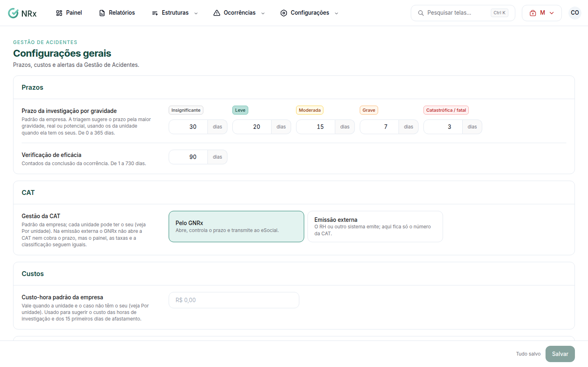

# Ajustar as configurações gerais

**Para que serve:** definir os prazos de investigação, a verificação de eficácia, como a CAT é emitida, o custo-hora, os alertas e o registro anônimo.


**Quem pode fazer:** Gestor ou Administrador, com a permissão de editar as configurações do módulo.


## Antes de começar

* Cada unidade pode ter os seus valores. O que você define aqui é o padrão da empresa.

## Passo a passo



### Abra as configurações

Clique em **Configurações › Geral**. Abre **Configurações gerais**.

<figure><figcaption>
Configurações gerais
</figcaption></figure>



### Ajuste os prazos

Em **Prazo da investigação por gravidade**, informe os dias de cada gravidade (de 0 a 365). A triagem sugere o prazo pela maior gravidade, real ou potencial. Em **Verificação de eficácia**, informe os dias contados da conclusão da ocorrência (de 1 a 730).



### Escolha a gestão da CAT

Em **Gestão da CAT**, escolha:

* **Pelo GNRx:** abre, controla o prazo e transmite ao eSocial;
* **Emissão externa:** o RH ou outro sistema emite; aqui fica só o número da CAT.



### Custo-hora, alertas e registro anônimo

Informe o **Custo-hora padrão da empresa**. Em **Alertas e registro**, cadastre os **E-mails da empresa** (recebem os alertas de todas as unidades). Em **Registro anônimo**, a opção prepara um canal que ainda não está disponível: hoje as ocorrências são registradas pelo painel. Clique em **Salvar**. Aparece "Configuração salva.".




**Por unidade:** em **Por unidade**, clique em **Personalizar** para dar valores próprios a uma unidade, ou **Usar os da empresa** para voltar ao padrão.


## Deu errado?

| Mensagem na tela | O que fazer |
| --- | --- |
| "Cada prazo vai de 0 a 365 dias." | Ajuste o prazo. |
| "Informe de 1 a 730 dias." | Ajuste os dias da verificação de eficácia. |

## Dúvidas comuns

Alguém quer comunicar algo sem se identificar.

Hoje não há canal anônimo de ocorrência. Para denunciar sem se identificar, use a denúncia da CIPA.

Ocorrência sem unidade avisa quem?

Os e-mails da empresa. Sem e-mail da empresa, ocorrências sem unidade não avisam ninguém.

