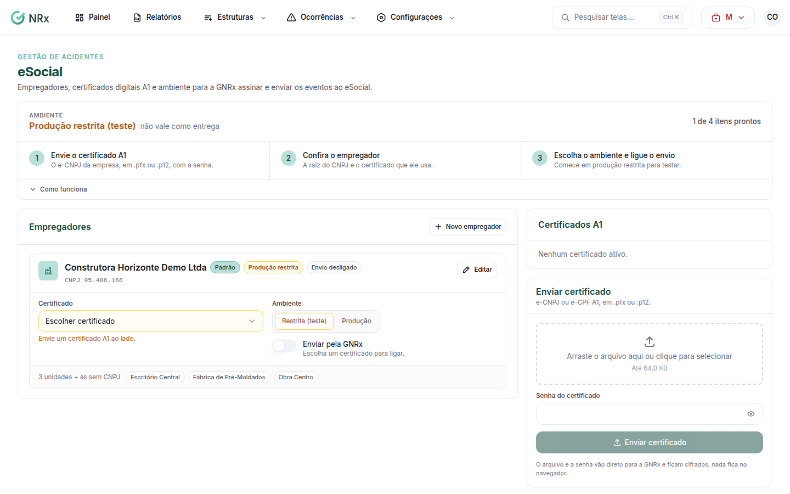

# Configurar o eSocial

**Para que serve:** preparar o GNRx para assinar e enviar ao eSocial a CAT (S-2210) e o afastamento (S-2230).


**Quem pode fazer:** Gestor ou Administrador, com a permissão de enviar o certificado digital e configurar a transmissão ao eSocial.


## Antes de começar

* Tenha o certificado digital A1 da empresa (e-CNPJ ou e-CPF), em arquivo .pfx ou .p12, e a senha.

## Passo a passo



### Envie o certificado

Clique em **Configurações › eSocial**. Clique em **Enviar certificado**, escolha o arquivo e digite a **Senha do certificado**.

<figure><figcaption>
eSocial
</figcaption></figure>



### Confira o empregador

Em **Novo empregador**, informe o nome e a **Raiz do CNPJ** (os 8 primeiros dígitos; o CNPJ completo só vale para órgão público). Escolha o certificado. Salve. Aparece "Empregador salvo.".



### Escolha o ambiente e ligue o envio

Comece em **Produção restrita (teste)**: não vale como entrega. Ligue **Transmitir pela GNRx**. Quando estiver tudo certo, use **Passar para produção** e digite PRODUÇÃO para confirmar.




Com o envio desligado, baixe o XML e informe o recibo do envio feito por fora.


## Deu errado?

| Mensagem na tela | O que fazer |
| --- | --- |
| "CNPJ inválido." | Use a raiz do CNPJ (8 dígitos). |
| "Outra raiz: a assinatura exige procuração eletrônica no e-CAC." | Use o certificado da própria empresa ou faça a procuração no e-CAC. |
| "Sem acesso à configuração do eSocial" | Peça a permissão de gerenciar certificados do eSocial. |

## Dúvidas comuns

Como tiro o certificado?

Clique em **Desativar** e confirme em **Desativar e apagar**. O arquivo e a senha são apagados da GNRx.

Tenho mais de um empregador.

Cadastre cada um em **Novo empregador**. Cada um pode usar o seu ambiente.

