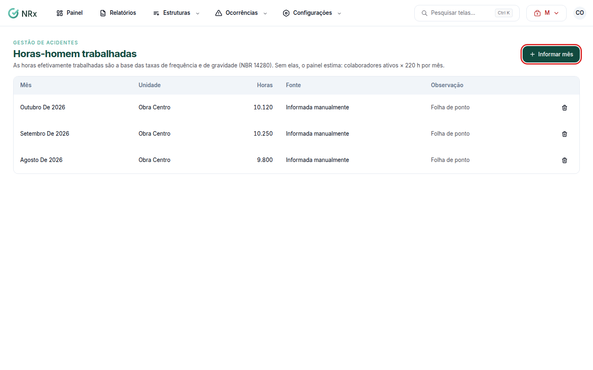

# Informar as horas-homem

**Para que serve:** informar as horas efetivamente trabalhadas de cada mês. Elas são a base das taxas de frequência e de gravidade (NBR 14280).


**Quem pode fazer:** Gestor ou Administrador, com a permissão de editar as configurações do módulo e as horas-homem.


## Antes de começar

* Tenha as horas trabalhadas do mês (ex.: da folha).

## Passo a passo



### Abra as horas-homem

Clique em **Configurações › Horas-homem** e depois em **Informar mês**.

<figure><figcaption>
Horas-homem trabalhadas
</figcaption></figure>



### Informe

Em **Informar horas do mês**, escolha o **Mês**, a unidade (ou **Toda a empresa**), as **Horas trabalhadas** e a **Observação** (ex.: folha de setembro). Salve. Aparece "Horas registradas.".



## Dúvidas comuns

E se eu não informar?

O painel estima as taxas. Aparece "Nenhum mês informado nos últimos 12 meses: as taxas do painel são estimadas.".

Errei um mês.

Remova o registro e informe de novo. Aparece "Registro removido.".

