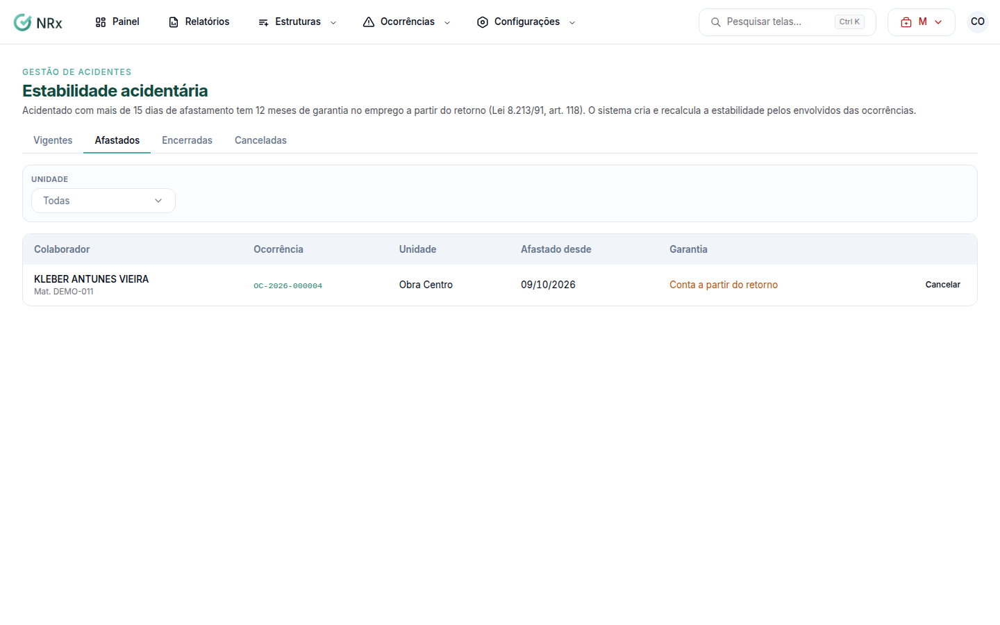

# Acompanhar a estabilidade acidentária

**Para que serve:** acompanhar quem tem garantia de emprego depois de um acidente. Acidentado com mais de 15 dias de afastamento tem 12 meses de garantia a partir do retorno (Lei 8.213/91, art. 118).


**Quem pode fazer:** quem tem a permissão de ver ocorrências.


## Antes de começar

* Registre o [afastamento e o retorno](../ocorrencias/registrar-afastamento.md) do acidentado.

## Passo a passo



### Abra as estabilidades

Clique em **Ocorrências › Estabilidade acidentária**. A lista mostra **Colaborador**, **Ocorrência**, **Unidade**, **Afastado desde** e **Garantia**.

<figure><figcaption>
Estabilidade acidentária
</figcaption></figure>



### Resolva um alerta

Clique em **Resolver** e registre o que foi feito: reintegração, acordo, justa causa comprovada etc. Aparece "Alerta resolvido.".



## Dúvidas comuns

A garantia não vale mais (ex.: o INSS negou o benefício).

Clique em **Cancelar estabilidade**. A garantia deixa de valer e o desligamento não pede mais justificativa. Para voltar, clique em **Reativar**.

Desde quando conta a garantia?

A partir do retorno ao trabalho. Se o retorno mudar, a estabilidade é recalculada.

