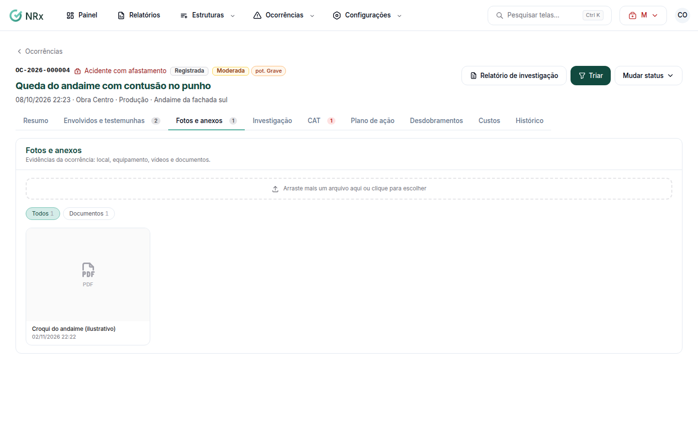

# Anexar fotos e documentos

**Para que serve:** guardar fotos, vídeos e documentos da ocorrência.


**Quem pode fazer:** Supervisor, Gestor ou Administrador, com a permissão de triar e tratar ocorrências. O anexo **Sensível** só abre para quem pode ver ocorrências e ver dados de saúde.


## Antes de começar

* Fotos e documentos: até 20 MB. Vídeos: até 100 MB. Formatos: JPG, PNG, WEBP, PDF ou MP4.

## Passo a passo



### Abra os anexos

Na ocorrência, abra a aba **Fotos e anexos**. Arraste uma foto, vídeo ou PDF, ou clique para escolher.

<figure><figcaption>
Fotos e anexos
</figcaption></figure>



### Descreva e envie

Escreva a **Descrição** (ex.: disco da serra sem coifa). Se o arquivo mostra lesão ou dado de saúde, marque **Sensível**. Clique em **Enviar**. Aparece "Anexo enviado.".



## Deu errado?

| Mensagem na tela | O que fazer |
| --- | --- |
| "Envie JPG, PNG, WEBP, PDF ou MP4." | Troque o formato. |
| "Fotos e documentos têm no máximo 20 MB." / "Vídeos têm no máximo 100 MB." | Use um arquivo menor. |
| "Não foi possível enviar. Confira a conexão e tente de novo." | Confira a internet e envie de novo. |

## Dúvidas comuns

Aparece "Anexos sensíveis ficam ocultos para o seu usuário".

Há anexos marcados como sensíveis. Você não tem a permissão de ver dados de saúde.

Como tiro um anexo?

Clique em **Remover anexo** e confirme em **Remover o anexo?**.

