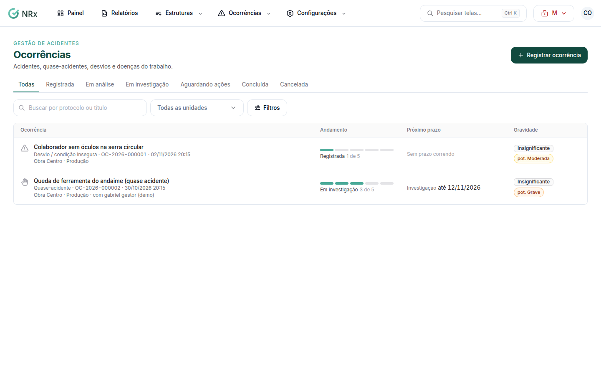

# Encontrar uma ocorrência

**Para que serve:** achar uma ocorrência e ver em que pé ela está.


**Quem pode fazer:** todas as roles, com a permissão de ver ocorrências. Você vê as ocorrências das unidades vinculadas a você.


## Antes de começar

* Nada a preparar.

## Passo a passo



### Abra a lista

Clique em **Ocorrências › Ocorrências**. A lista mostra **Ocorrência**, **Andamento**, **Próximo prazo**, **Gravidade**, **CAT** e **Investigação**.

<figure><figcaption>
Ocorrências
</figcaption></figure>



### Filtre

Use **Buscar por protocolo ou título**, a unidade, o **Tipo**, o **Responsável** e **Ocorridas entre**. Para ver só o que está atrasado, ligue **Só com investigação atrasada**.



## Dúvidas comuns

Apareceu "Ocorrência não encontrada".

A ocorrência não existe ou está fora das unidades que você acessa.

Apareceu "Nenhuma ocorrência ainda".

Registrar quase-acidentes e desvios é o que evita o próximo acidente. Veja [Registrar uma ocorrência](registrar-ocorrencia.md).

