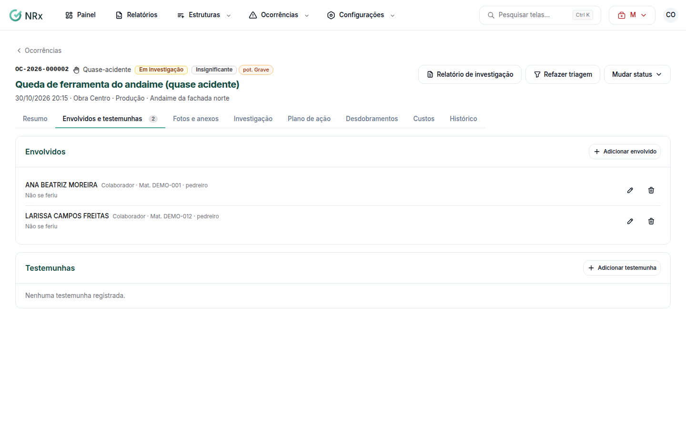

# Registrar envolvidos e testemunhas

**Para que serve:** registrar quem se feriu, quem estava envolvido e quem presenciou, com o depoimento.


**Quem pode fazer:** Supervisor, Gestor ou Administrador, com a permissão de triar e tratar ocorrências.


## Antes de começar

* Abra a ocorrência.

## Passo a passo



### Abra os envolvidos

Na ocorrência, abra a aba **Envolvidos e testemunhas**.

<figure><figcaption>
Envolvidos e testemunhas
</figcaption></figure>



### Adicione um envolvido

Clique em **Adicionar envolvido**. Escolha o colaborador e a situação: **Acidentado** (**Óbito**, **Com afastamento** ou **Sem afastamento**) ou **Não se feriu**. Clique em **Salvar**. Se for acidentado, aparece "Envolvido adicionado. A CAT foi aberta.".



### Adicione as testemunhas

Clique em **Adicionar testemunha**. Busque o colaborador (ou informe o nome), o **Contato**, a data em **Depoimento colhido em** e o **Depoimento**. Salve. Aparece "Testemunha salva.".



## Dúvidas comuns

Não consigo remover um envolvido.

Ele tem CAT aberta: não pode ser removido.

A testemunha não é colaborador.

Informe só o nome e o contato.

