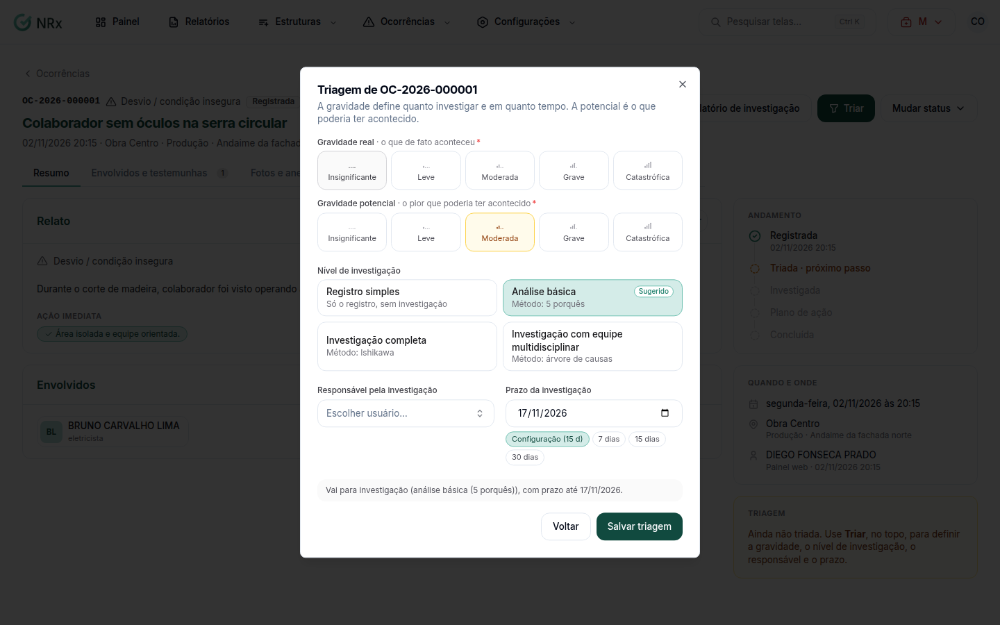

# Fazer a triagem

**Para que serve:** definir a gravidade, o nível de investigação, quem investiga e o prazo.


**Quem pode fazer:** Supervisor, Gestor ou Administrador, com a permissão de triar e tratar ocorrências.


## Antes de começar

* [Registre a ocorrência](registrar-ocorrencia.md).

## Passo a passo



### Abra a triagem

Abra a ocorrência e clique em **Triar**, no cabeçalho. Abre **Triagem de <protocolo>**.

<figure><figcaption>
Triagem
</figcaption></figure>



### Preencha

Escolha a **Gravidade real** e a **Gravidade potencial**. O sistema mostra o **Nível de investigação** **Sugerido**. Escolha o **Responsável pela investigação** e o **Prazo da investigação**. Para só registrar, escolha **Só o registro, sem investigação**.



### Salve

Clique em **Salvar triagem**. Aparece "Triagem registrada.".



## Dúvidas comuns

Errei a triagem.

No cabeçalho da ocorrência, o botão vira **Refazer triagem**.

O que é a gravidade potencial?

É o que poderia ter acontecido. Um quase-acidente pode ter gravidade real baixa e potencial alta.

