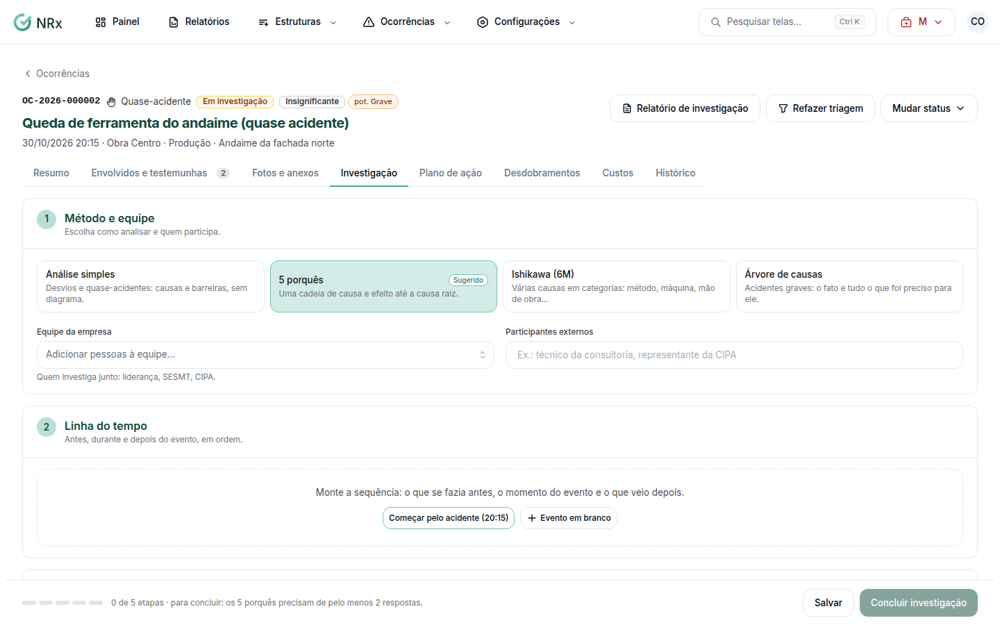

# Investigar uma ocorrência

**Para que serve:** descobrir por que aconteceu e onde o plano de ação deve agir.


**Quem pode fazer:** Supervisor, Gestor ou Administrador, com a permissão de conduzir a investigação.


## Antes de começar

* [Faça a triagem](fazer-triagem.md).

## Passo a passo



### Escolha o método e a equipe

Na aba de investigação, em **Método e equipe**, escolha o método:

* **Causas e barreiras:** desvios e quase-acidentes, sem diagrama;
* **5 porquês:** uma cadeia de causa e efeito até a causa raiz;
* **Ishikawa (6M):** várias causas em categorias;
* **Árvore de causas:** acidentes graves.

Adicione a **Equipe da empresa** (liderança, SESMT, CIPA) e os **Participantes externos**.

<figure><figcaption>
Investigação
</figcaption></figure>



### Monte a linha do tempo

Em **Linha do tempo**, clique em **Adicionar evento** e conte o antes, o durante e o depois, em ordem.



### Analise as causas

Preencha o método escolhido. Em **Causas e barreiras**, informe as **Causas imediatas** (o ato e a condição), as **Causas básicas** (gestão, projeto, treinamento) e as **Barreiras que falharam**.



### Conclua

Escreva a conclusão: o que aconteceu, por quê e o que muda. Informe as **Horas gastas na investigação**. Clique em **Concluir investigação**. Aparece "Investigação concluída. Agora, o plano de ação.".



## Deu errado?

| Mensagem na tela | O que fazer |
| --- | --- |
| "Escolha como analisar e quem participa." | Escolha o método e a equipe. |
| "Os 5 porquês precisam de pelo menos 2 respostas." | Responda mais um porquê. |
| "Informe ao menos uma causa no Ishikawa." | Informe uma causa. |
| "A árvore de causas precisa do fato e de ao menos uma causa." | Complete a árvore. |
| "Informe as causas básicas ou as barreiras que falharam." | Preencha uma das duas. |
| "Escreva a conclusão." | Escreva a conclusão. |

## Dúvidas comuns

Posso salvar e continuar depois?

Pode. Clique em **Salvar**. Aparece "Investigação salva.".

As horas da investigação contam no custo?

Sim. Entram nos custos (horas × custo-hora).

