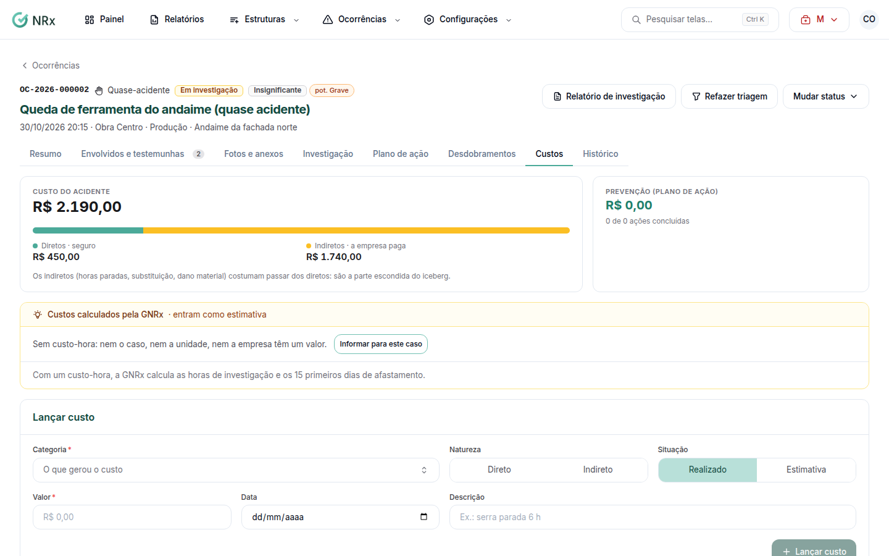

# Lançar os custos do acidente

**Para que serve:** registrar quanto o acidente custou: diretos, indiretos e prevenção.


**Quem pode fazer:** Gestor ou Administrador, com a permissão de lançar custos dos acidentes. Para só ver, a permissão de ver os custos.


## Antes de começar

* Abra a ocorrência.

## Passo a passo



### Abra os custos

Na ocorrência, abra **Custo do acidente**. Os custos ficam em **Diretos · seguro**, **Indiretos · a empresa paga** e **Prevenção (plano de ação)**.

<figure><figcaption>
Custo do acidente
</figcaption></figure>



### Lance o custo

Clique em **Lançar custo**. Escolha a **Categoria**, a **Natureza** e a **Situação**, e informe o **Valor** e a **Data**. Clique em **Adicionar**.




**Custos calculados pela GNRx** (como as horas da investigação) entram como estimativa. Em **Custo-hora deste caso**, use **Informar para este caso** ou **Voltar ao padrão**.


## Dúvidas comuns

De onde vem o custo-hora?

Das configurações do módulo. Neste caso, você pode informar outro.

A categoria que preciso não existe.

Peça a quem cuida das configurações do módulo para cadastrar em **Configurações › Catálogos**.

