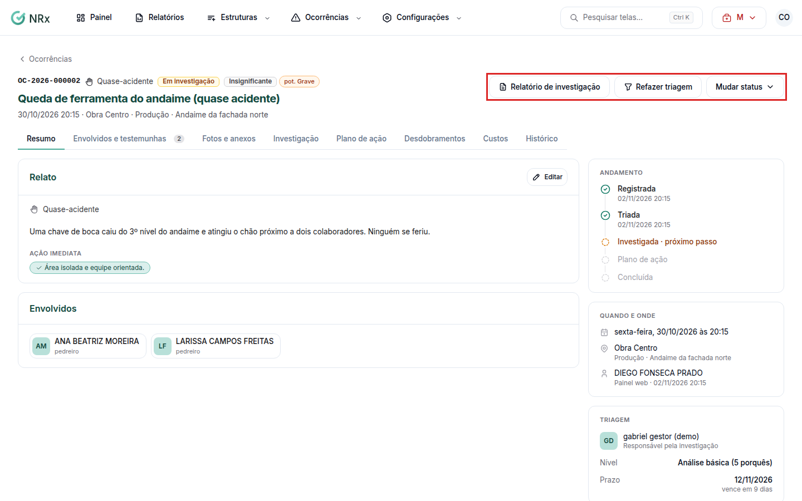

# Mudar o status de uma ocorrência

**Para que serve:** mudar o andamento da ocorrência, verificar a eficácia, reabrir ou cancelar.


**Quem pode fazer:** Supervisor, Gestor ou Administrador, com a permissão de triar e tratar ocorrências (inclui reabrir, cancelar e verificar a eficácia).


## Antes de começar

* Abra a ocorrência.

## Passo a passo



### Mude o status

No cabeçalho da ocorrência, clique em **Mudar status** e escolha o novo status no menu. Aparece "Ocorrência em" seguido do novo status.

<figure><figcaption>
Cabeçalho da ocorrência
</figcaption></figure>



### Verifique a eficácia (quando chegar a hora)

Quando a ocorrência está concluída e chega a data de verificar a eficácia, aparece **Verificar eficácia** no cabeçalho. Clique e registre. Aparece "Verificação de eficácia registrada.".




**O que aparece em cada status:** **Relatório de investigação** aparece sempre. **Triar** (ou **Refazer triagem**) e **Cancelar ocorrência** só aparecem enquanto a ocorrência não está concluída nem cancelada. **Verificar eficácia** só aparece na ocorrência concluída, a partir da data de verificação.


## Dúvidas comuns

Como cancelo uma ocorrência?

Clique em **Mudar status** e, no fim do menu, em **Cancelar ocorrência**. O sistema avisa: "A ocorrência sai das listas de pendências. Não é possível cancelar com CAT já comunicada."

Preciso voltar a investigar.

Na ocorrência concluída, clique em **Mudar status** e escolha **Reabrir (em investigação)**.

Como guardo a investigação?

Clique em **Relatório de investigação**.

