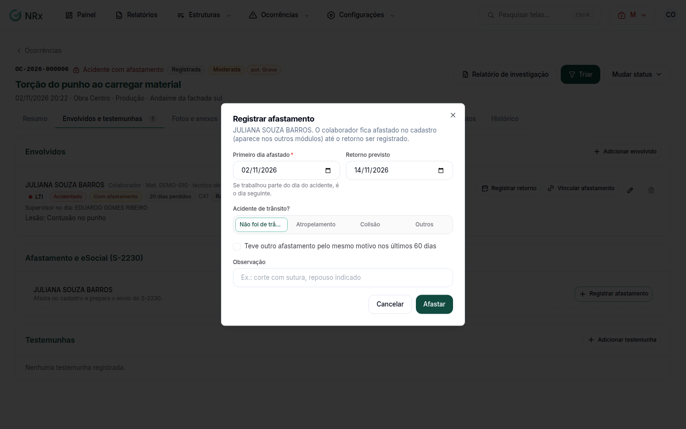

# Registrar o afastamento do acidentado

**Para que serve:** registrar que o acidentado ficou afastado, o retorno ao trabalho e preparar o envio ao eSocial (S-2230).


**Quem pode fazer:** Supervisor, Gestor ou Administrador, com a permissão de triar e tratar ocorrências.


## Antes de começar

* O acidentado precisa estar em [Envolvidos e testemunhas](envolvidos-e-testemunhas.md).

## Passo a passo



### Registre o afastamento

No envolvido, em **Afastamento e eSocial (S-2230)**, clique em **Registrar afastamento**. Informe o **Primeiro dia afastado**, o **Retorno previsto**, se foi **Acidente de trânsito** e a **Observação**. Clique em **Registrar**. Aparece "Afastamento registrado: o colaborador está afastado.".

<figure><figcaption>
Registrar afastamento
</figcaption></figure>



### Envie ao eSocial

Clique em **Enviar o início** (ou **Enviar início e término**). Aparece "Enviado ao eSocial. A resposta chega em alguns minutos.". Se enviou por outro sistema, use **Enviado por fora? Informar recibo** e informe o **Número do recibo**.



### Registre o retorno

Quando a pessoa voltar, clique em **Registrar retorno** e informe o **Primeiro dia de volta ao trabalho**. Aparece "Retorno registrado: o colaborador está ativo de novo.". Depois, clique em **Enviar o término**.



## Deu errado?


**"O envio pela GNRx está desligado nas configurações do eSocial."**: peça a quem cuida das configurações do módulo para ligar o envio, ou informe o recibo do envio feito por fora.


## Dúvidas comuns

A pessoa se afastou de novo pelo mesmo acidente.

Registre um novo afastamento.

O retorno muda a estabilidade?

Sim. A estabilidade é recalculada a partir da data do retorno.

