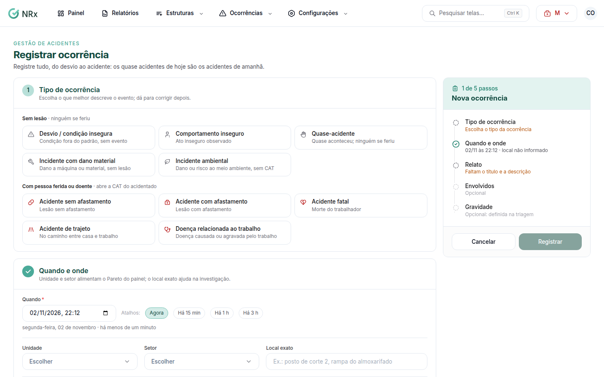
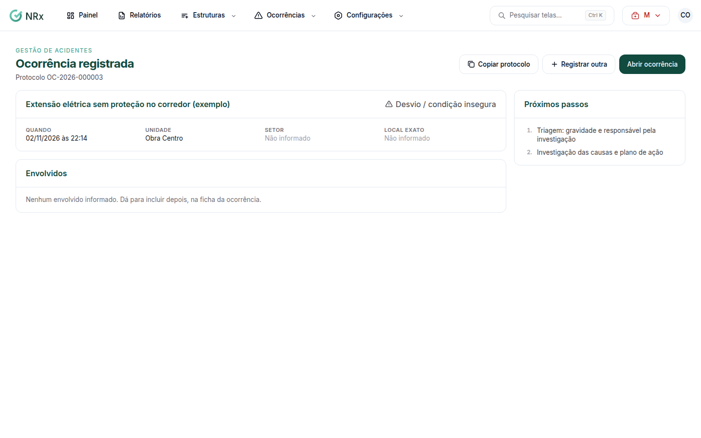

# Registrar uma ocorrência

**Para que serve:** registrar o que aconteceu, onde e com quem, logo depois do evento.


**Quem pode fazer:** todas as roles (Operador, Supervisor, Gestor e Administrador), com a permissão de registrar ocorrências.


## Antes de começar

* Se houve alguém ferido, tenha o nome do colaborador acidentado.

## Passo a passo



### Escolha o tipo

Clique em **Ocorrências › Registrar ocorrência**. Em **Tipo de ocorrência**, escolha o que melhor descreve o evento: condição fora do padrão, ato inseguro, quase-acidente, dano material, lesão com ou sem afastamento, morte, trajeto, doença do trabalho ou dano ambiental. Dá para corrigir depois.

<figure><figcaption>
Tipo de ocorrência
</figcaption></figure>



### Diga quando e onde

Em **Quando e onde**, informe a data e a hora (use os atalhos **Há 15 min**, **Há 1 h**, **Há 3 h**). Escolha a **Unidade**, o **Setor** e o **Local exato** (ex.: posto de corte 2).



### Descreva

Dê um **Título** (ex.: Corte na mão direita na serra circular). Na **Descrição**, conte os fatos, sem culpados: o que a pessoa fazia e como aconteceu. **Usar roteiro** ajuda. Em **Ação imediata**, marque o que foi feito na hora (ex.: **Primeiros socorros**, **Área isolada**).



### Adicione os envolvidos

Se houve lesão, clique em **Adicionar acidentado** e escolha o colaborador. Ele é obrigatório para a CAT. Se quiser, clique em **Adicionar envolvido** para quem estava junto ou presenciou.



### Registre

Clique em **Registrar**. Aparece **Ocorrência registrada**, com o protocolo e os **Próximos passos**. Se gerar CAT, aparece **CAT aberta**, com o prazo legal.

<figure><figcaption>
Ocorrência registrada
</figcaption></figure>



## Deu errado?

| Mensagem na tela | O que fazer |
| --- | --- |
| "Escolha o tipo da ocorrência" | Escolha o tipo. |
| "A data não pode estar no futuro" | Corrija a data. |
| "Faltam o título e a descrição" | Preencha os dois. |
| "Adicione o acidentado para abrir a CAT" | Clique em **Adicionar acidentado**. |
| "Complete os dados dos envolvidos" | Preencha os dados de cada envolvido. |

## Dúvidas comuns

Qual o prazo da CAT?

Até o 1º dia útil seguinte ao acidente (ou ao diagnóstico, na doença). Em caso de morte, a comunicação é imediata.

Preciso definir a gravidade agora?

Não. A gravidade é opcional agora: pode ser definida na [triagem](fazer-triagem.md).

