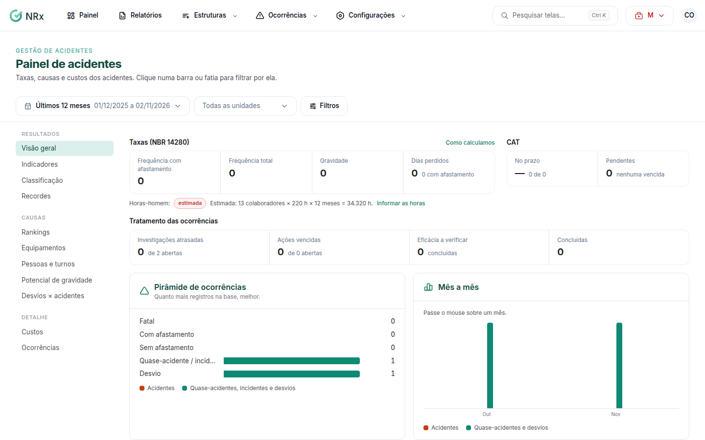

# Ver o painel de acidentes

**Para que serve:** acompanhar os indicadores de acidentes e desvios: onde, o quê, como, gravidade e custos.


**Quem pode fazer:** quem tem a permissão de ver ocorrências. Os custos só aparecem para quem pode ver os custos dos acidentes.


## Antes de começar

* Para taxas exatas, informe as [horas-homem](../configuracoes/horas-homem.md).

## Passo a passo



### Abra o painel

Clique em **Painel**. Abre o **Painel de acidentes**.

<figure><figcaption>
Painel de acidentes
</figcaption></figure>



### Escolha a visão

Escolha a visão: **Visão geral**, **Indicadores**, **Classificação**, **Potencial de gravidade**, **Desvios × acidentes**, **Pessoas e turnos**, **Equipamentos**, **Rankings**, **Recordes** ou **Custos**. Use os filtros de período e de unidade.



## Dúvidas comuns

As taxas aparecem como estimadas.

Faltam as horas-homem do período. Veja [Informar as horas-homem](../configuracoes/horas-homem.md).

Não vejo a visão Custos.

Ela só aparece para quem tem a permissão de ver os custos dos acidentes.

