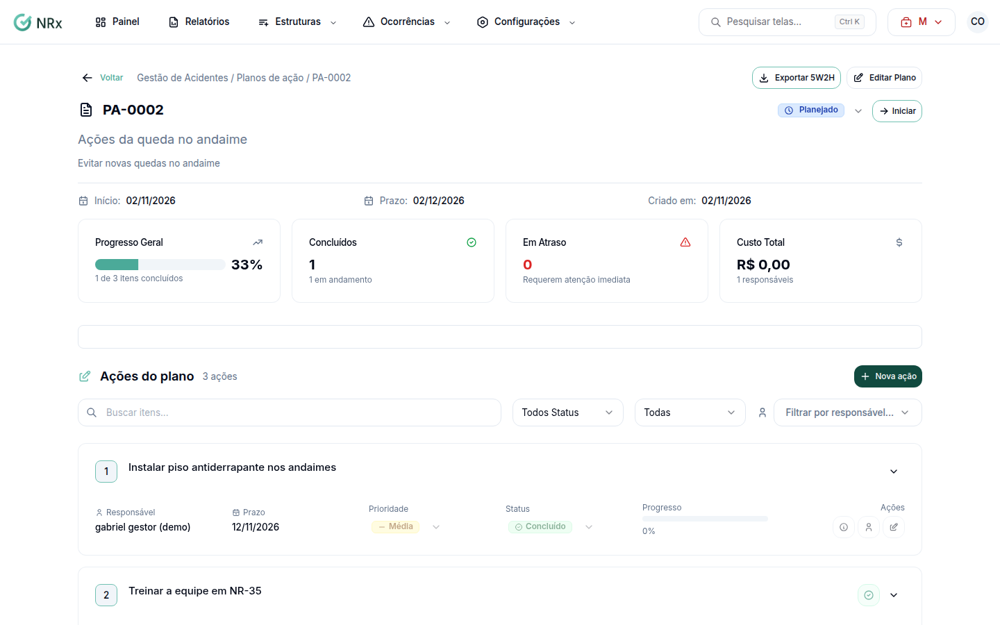

# Acompanhar um plano de ação

**Para que serve:** cadastrar as ações do plano (o quê, por quê, como, onde, quem, quando e quanto custa) e acompanhar até concluir.


**Quem pode fazer:** todas as roles (Operador, Supervisor, Gestor e Administrador), com as permissões de editar planos de ação e itens de plano de ação.


## Antes de começar

* Abra o plano de ação.

## Passo a passo



### Adicione as ações

No plano, clique em **Nova ação**. Preencha **[What] O que será feito?**, **[Why] Por que será feito?**, **[How] Como será feito?**, **[Where] Onde será feito?** e **[How Much] Quanto custa?**.

<figure><figcaption>
Plano de ação
</figcaption></figure>



### Defina quem e quando

Na ação, use **Atribuir Responsável e Prazo**: escolha o **[Who] Responsável** e o **[When] Prazo**.



### Acompanhe

Mude o status de cada ação (**Planejado**, **Em Andamento**, **Concluído** ou **Cancelado**) e a prioridade (**Alta**, **Média** ou **Baixa**). Anexe fotos e PDF de até 20 MB como evidência.



### Conclua o plano

Com todas as ações concluídas ou canceladas, conclua o plano em **Concluir Plano de Ação**. O plano é finalizado, os itens não podem mais ser editados e a data de conclusão é registrada.



## Deu errado?

| Mensagem na tela | O que fazer |
| --- | --- |
| "Não é possível concluir o plano de ação. Existem itens não finalizados/cancelados." | Conclua ou cancele as ações que faltam. |
| **Dados Incompletos** | Preencha o que falta ou clique em **Iniciar Assim Mesmo** / **Concluir Assim Mesmo**. |
| "Arquivo recusado" | Envie foto ou PDF de até 20 MB. |

## Dúvidas comuns

Como levo o plano para uma reunião?

Clique em **Exportar 5W2H** e escolha **PDF** (pronto para impressão) ou **Excel** (planilha com filtros por coluna).

Como mudo o nome ou o prazo do plano?

Clique em **Editar Plano**. Em **Editar Plano de Ação**, ajuste o nome, a descrição, o status, a **Data de Início** e o **Prazo Final**.

