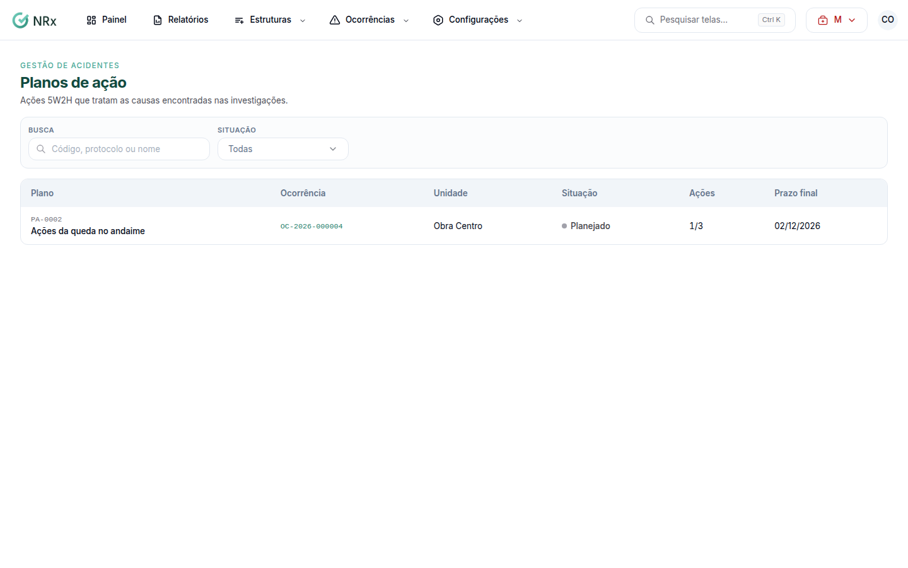

# Encontrar um plano de ação

**Para que serve:** ver os planos de ação 5W2H que tratam as causas encontradas nas investigações.


**Quem pode fazer:** todas as roles, com a permissão de ver planos de ação.


## Antes de começar

* O plano é criado na aba **Plano de ação** de cada ocorrência (abas: Resumo, Envolvidos e testemunhas, Fotos e anexos, Investigação, CAT, Plano de ação, Desdobramentos, Custos e Histórico). Clique em **Criar plano de ação** depois da investigação. É um plano por ocorrência.

## Passo a passo



### Abra os planos

Clique em **Ocorrências › Planos de ação**. A lista mostra **Plano**, **Situação**, **Ações** e **Prazo final**.

<figure><figcaption>
Planos de ação
</figcaption></figure>



### Busque e abra

Use **Código, protocolo ou nome** e clique no plano. Veja [Acompanhar um plano de ação](acompanhar-plano.md).



## Dúvidas comuns

Apareceu "Nenhum plano ainda".

O plano é criado na aba **Plano de ação** de cada ocorrência.

Posso abrir o plano pela ocorrência?

Pode. Na aba **Plano de ação**, clique em **Abrir plano**.

