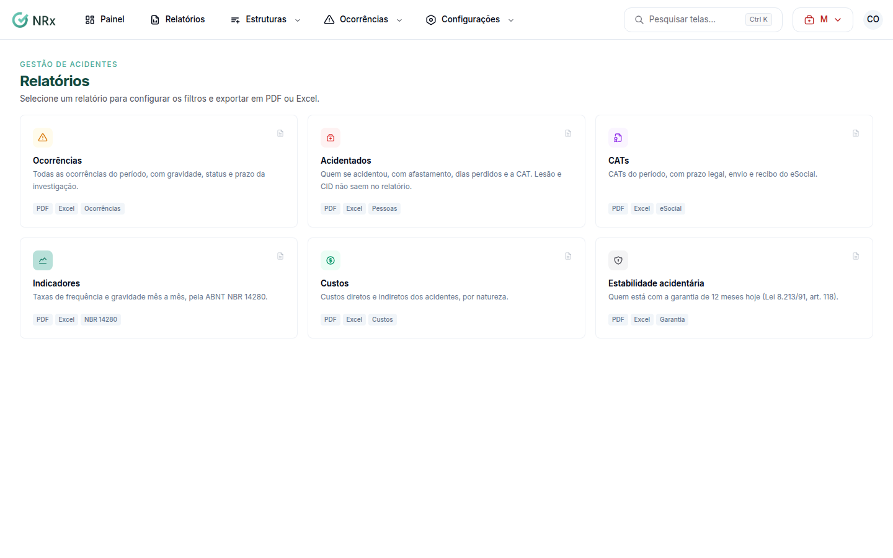

# Gerar um relatório de acidentes

**Para que serve:** exportar os relatórios da Gestão de Acidentes em PDF ou Excel, como os da NBR 14280.


**Quem pode fazer:** quem tem a permissão de ver ocorrências.


## Antes de começar

* Nada a preparar.

## Passo a passo



### Escolha o relatório

Clique em **Relatórios** e escolha o relatório.

<figure><figcaption>
Relatórios
</figcaption></figure>



### Escolha o período

Em **Período (data da ocorrência)**, use **Este mês**, **Mês passado**, **Últimos 12 meses** ou informe o **Início do período** e o **Fim do período**. Se quiser, escolha **Agrupar por**.



### Baixe

Clique em **Baixar PDF** ou **Baixar Excel**.



## Deu errado?


**"A data inicial do período é depois da final."**: corrija as datas.


## Dúvidas comuns

Não aparece a prévia.

Preencha o período para ver a prévia.

Posso abrir no Excel?

Pode. Clique em **Baixar Excel**.

