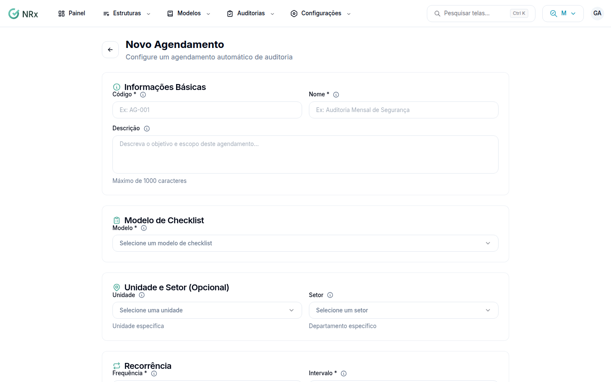

# Agendar auditorias automáticas

**Para que serve:** fazer o GNRx criar as auditorias sozinho, na frequência certa, e avisar quem executa. Ex.: inspeção de extintores todo dia 5.


**Quem pode fazer:** todas as roles.


## Antes de começar

* Tenha um modelo [NR](../modelo-nr.md) ou [customizado](../modelo-customizado.md) disponível.
* Tenha os usuários que vão executar cadastrados. Veja [Criar um usuário](../estrutura/usuarios/criar-usuario.md).

## Passo a passo



### Abra o novo agendamento

Clique em **Agendamento de Auditorias** e em **Novo Agendamento**.

<figure><figcaption>
Novo Agendamento
</figcaption></figure>



### Preencha o básico

Informe o **Código**, o **Nome** e, se quiser, a **Descrição**. Escolha o **Modelo** e, se quiser, a **Unidade** e o **Setor**.



### Defina quando

Em **Período de Vigência**, informe a **Data Início** e, se quiser, a **Data Fim**. Em **Recorrência**, escolha a **Frequência** (Diária, Semanal, Mensal ou Anual) e o **Intervalo**. Confira o **Resumo da Recorrência**.



### Escolha as pessoas

Em **Executores**, adicione pelo menos um usuário. Arraste para mudar a ordem de execução. Se quiser, adicione **Gestores** para receber e-mail antes da execução ou após a conclusão.



### Crie

Em **Configurações de Notificação**, marque **Notificar Executores** e os **Dias de Antecedência**, se quiser. Clique em **Criar Agendamento**.



## Deu errado?


**"Corrija os seguintes erros:"**: corrija cada campo da lista e clique em **Criar Agendamento** de novo.


## Dúvidas comuns

Semanal ou mensal sem escolher o dia?

O GNRx usa o dia da **Data Início**.

Como altero ou paro o agendamento?

Veja [Editar ou inativar um agendamento](editar-agendamento.md).

