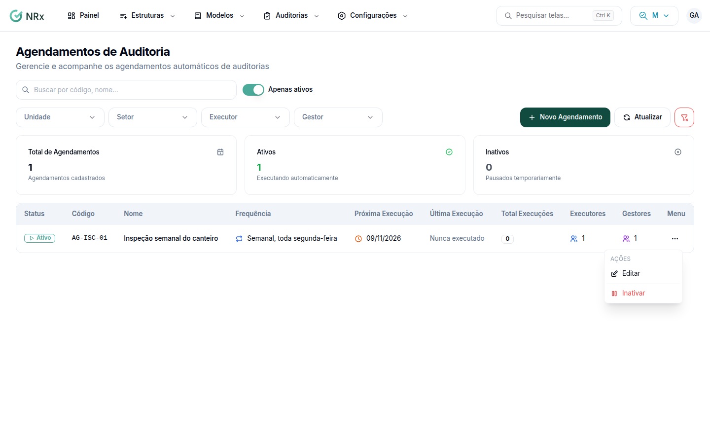

# Editar ou inativar um agendamento

**Para que serve:** mudar o nome ou os avisos de um agendamento, ou parar de criar as auditorias automáticas.


**Quem pode fazer:** todas as roles.


## Antes de começar

* Tenha um [agendamento](criar-agendamento.md) criado.

## Passo a passo



### Abra o menu

Clique em **Agendamento de Auditorias** e abra o menu da linha.

<figure><figcaption>
Agendamentos de Auditoria
</figcaption></figure>



### Para editar

Clique em **Editar**. Altere o **Nome**, a **Descrição** ou os avisos e clique em **Salvar Alterações**.



### Para inativar

Clique em **Inativar**, leia o que vai acontecer e clique em **Inativar Agendamento**. Aparece "Agendamento inativado com sucesso".



## Dúvidas comuns

O que acontece ao inativar?

As execuções futuras são canceladas, os avisos param e nenhuma auditoria nova é criada. As auditorias já criadas continuam.

Como mudo o modelo ou a frequência?

Não dá na edição. Inative e crie um agendamento novo.

