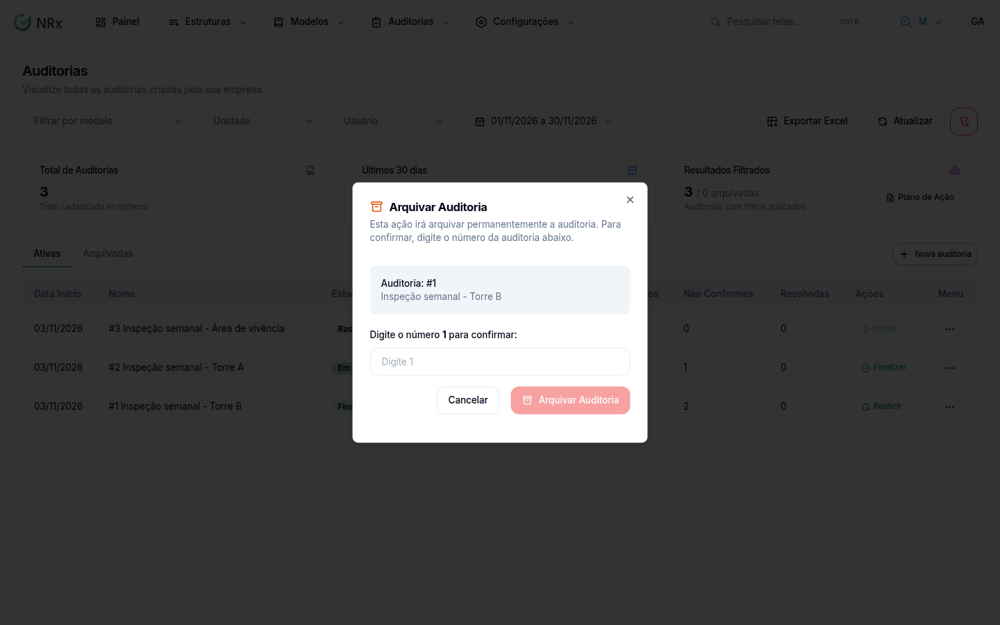

# Arquivar uma auditoria

**Para que serve:** tirar da lista uma auditoria que não deve mais aparecer entre as ativas. Ex.: uma auditoria criada por engano.


**Quem pode fazer:** Gestor ou Administrador, com a permissão de arquivar auditorias.


## Passo a passo



### Abra o menu

Em **Auditorias**, abra o menu da linha e clique em **Arquivar**.

<figure><figcaption>
Arquivar Auditoria
</figcaption></figure>



### Confirme

Digite o número da auditoria e clique em **Arquivar Auditoria**. Aparece "Auditoria arquivada com sucesso".



## Deu errado?


**"Digite o número da auditoria para confirmar"**: digite o número mostrado na janela.


## Dúvidas comuns

Onde ela fica?

Na aba **Arquivadas** de **Auditorias**.

Dá para desarquivar?

Não pela tela. O arquivamento é permanente.

