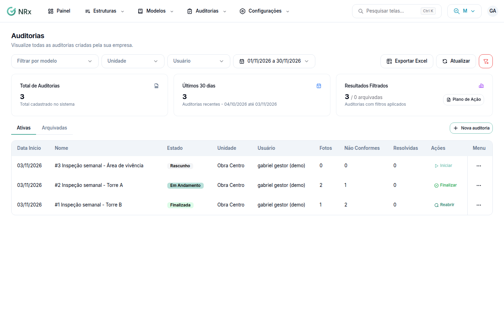

# Encontrar uma auditoria

**Para que serve:** achar uma auditoria e ver o andamento. Ex.: as auditorias da unidade Centro feitas por um auditor.


**Quem pode fazer:** todas as roles, com a permissão de ver auditorias. Para ver as auditorias de todos os usuários: Gestor ou Administrador, com a permissão de ver as auditorias de todos os usuários.


## Passo a passo



### Abra a lista

Clique em **Auditorias**. A aba **Ativas** já vem aberta.

<figure><figcaption>
Auditorias
</figcaption></figure>



### Filtre

Use os filtros de modelo, **Unidade** e **Usuário**. Clique em **Atualizar** para recarregar.



### Abra a auditoria

Clique no nome, ou no menu da linha e em **Visualizar**.



## Dúvidas comuns

O que cada coluna mostra?

**Estado** (Rascunho, Em Andamento, Finalizada ou Cancelada), **Fotos**, **Não Conformes** e **Resolvidas**.

Como levo a lista para o Excel?

Clique em **Exportar Excel**. Sai a lista com os filtros aplicados.

Onde estão as auditorias arquivadas?

Na aba **Arquivadas**. Veja [Arquivar uma auditoria](arquivar-auditoria.md).

