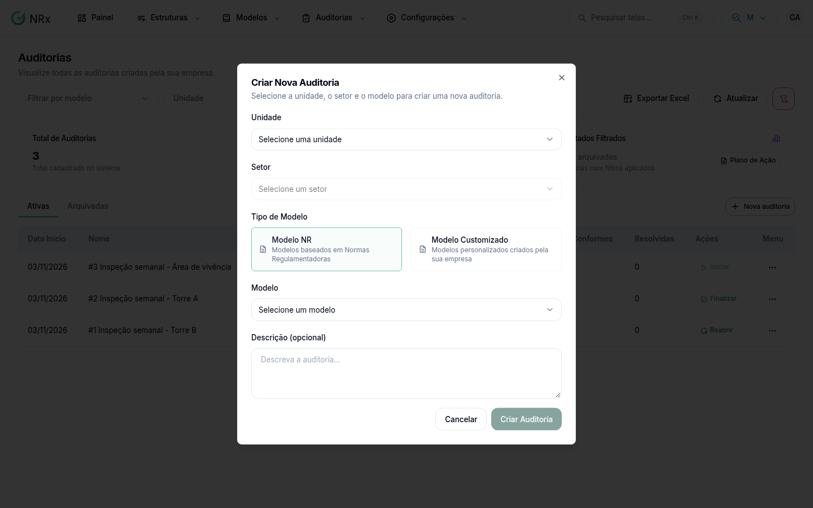

# Criar uma auditoria

**Para que serve:** abrir uma auditoria nova, numa unidade e num setor, a partir de um modelo. Ex.: inspeção de extintores do almoxarifado.


**Quem pode fazer:** todas as roles, com a permissão de criar auditorias.


## Antes de começar

* Tenha um modelo [NR](modelo-nr.md) ou [customizado](modelo-customizado.md) disponível.
* Tenha a [unidade](estrutura/unidades/criar-unidade.md) vinculada ao seu usuário, com o [setor](estrutura/setores/criar-setor.md) associado a ela.

## Passo a passo



### Abra a nova auditoria

Clique em **Auditorias** e em **Nova auditoria**.

<figure><figcaption>
Criar Nova Auditoria
</figcaption></figure>



### Escolha onde e o quê

Escolha a **Unidade**, o **Setor**, o **Tipo de Modelo** (Modelo NR ou Modelo Customizado) e o **Modelo**.



### Preencha o cabeçalho

Se o modelo tiver **Cabeçalho**, preencha os campos. Os marcados como **Obrigatório** não podem ficar vazios. Se quiser, escreva a **Descrição**.



### Crie

Clique em **Criar Auditoria**. O GNRx abre a página da auditoria.



## Deu errado?

| Mensagem na tela | O que fazer |
| --- | --- |
| "Unidade é obrigatória" | Escolha a unidade. |
| "Setor é obrigatório" | Escolha o setor. |
| "Modelo é obrigatório" | Escolha o modelo. |
| "Descrição não pode exceder 255 caracteres" | Encurte a descrição. |
| "Ocorreu um erro ao carregar os dados" | Feche a janela e abra de novo. |

## Dúvidas comuns

E agora?

Preencha a auditoria. Veja [Preencher uma auditoria](preencher-auditoria.md).

Não acho a unidade ou o setor?

A unidade precisa estar vinculada ao seu usuário e o setor precisa estar associado a ela. Fale com o administrador.

Não acho o modelo?

O modelo customizado precisa estar **Disponível**. Veja [Disponibilizar, revisar ou inativar um modelo](modelos/disponibilizar-modelo.md).

Pelo celular?

Também dá. Veja o [aplicativo](../aplicativo/nova-auditoria.md).

