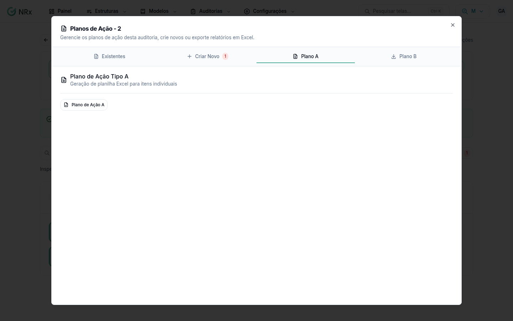

# Baixar a planilha do plano de ação

**Para que serve:** baixar em Excel os itens que pedem ação, para tratar fora do sistema ou mandar ao cliente.


**Quem pode fazer:** todas as roles, com a permissão de ver auditorias.


## Passo a passo



### De uma auditoria

Abra a auditoria e clique em **Planos de Ação**. Na aba **Plano A** (uma linha por item), clique em **Plano de Ação A**. Na aba **Plano B** (estruturada como projeto), clique em **Plano de Ação B**.

<figure><figcaption>
Planos de Ação da auditoria
</figcaption></figure>



### De várias auditorias

Em **Auditorias**, filtre as auditorias e clique em **Plano de Ação**. Escolha **Plano de ação A** ou **Plano de ação B**.



### Baixe

Aparece "Plano de ação gerado com sucesso" e o download do Excel começa.



## Deu errado?


**"Erro ao gerar plano de ação"**: tente de novo.


## Dúvidas comuns

Quero acompanhar as ações dentro do GNRx?

Crie um plano de ação. Veja [Criar um plano de ação a partir da auditoria](planos-acao/criar-plano.md).

A ou B?

O A traz cada item numa linha. O B organiza os itens como um projeto.

