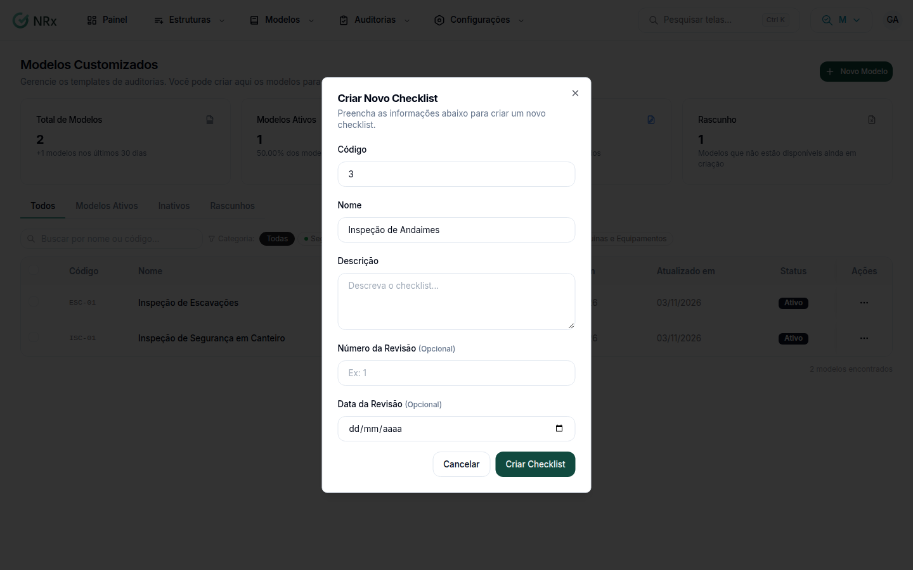
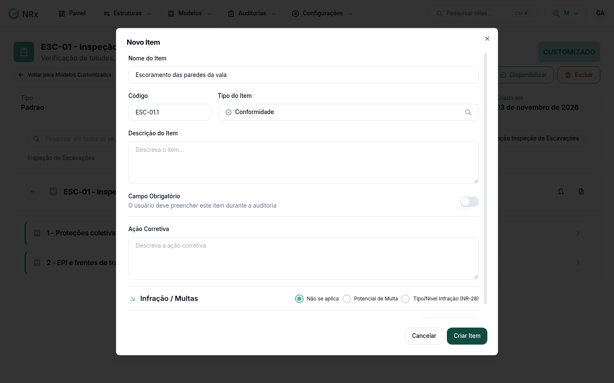

# Criar um modelo customizado

**Para que serve:** montar o checklist da sua empresa, com os itens e tipos de resposta que você precisa. Ex.: inspeção diária de empilhadeira com foto e assinatura.


**Quem pode fazer:** Gestor ou Administrador, com as permissões de criar e de editar modelos.


## Passo a passo



### Abra o novo modelo

Clique em **Modelos Customizados** e em **Novo Modelo**.

<figure><figcaption>
Criar Novo Checklist
</figcaption></figure>



### Preencha e crie

Informe o **Código**, o **Nome** e, se quiser, a **Descrição**, o **Número da Revisão** e a **Data da Revisão**. Clique em **Criar Checklist**. O modelo nasce em **Rascunho**.



### Crie uma seção

Clique no nome do modelo para abri-lo. Clique em **Nova Seção**, informe **Nome**, **Código**, **Ordem** e, se quiser, a **Descrição**, e clique em **Criar Seção**.



### Crie os itens

Clique em **Novo Item**. Informe o **Nome do Item**, o **Código** e o **Tipo do Item**. Se quiser, preencha a **Descrição do Item** e a **Ação Corretiva** e marque **Campo Obrigatório**. Clique em **Criar Item**.

<figure><figcaption>
Novo Item
</figcaption></figure>



### Disponibilize

Quando terminar, clique em **Disponibilizar** e em **Confirmar**. Só então o modelo pode ser usado nas auditorias. Veja [Disponibilizar, revisar ou inativar um modelo](modelos/disponibilizar-modelo.md).



## Deu errado?


**"Código é obrigatório"**: informe o código.



**"Nome é obrigatório"**: informe o nome.



**"Ocorreu um erro ao criar o checklist."**: tente de novo.


## Dúvidas comuns

Qual tipo de item escolher?

Veja [Escolher o tipo de item](modelos/tipos-de-item.md).

Como peço dados no início da auditoria?

Clique em **Editar Cabeçalhos** e em **Adicionar Campo de Cabeçalho**. Informe o **Nome do Campo**, o **Tipo** (Texto, Número, Data ou Sim/Não) e se é **Obrigatório**. Clique em **Salvar Cabeçalhos**. O auditor preenche esses campos ao criar a auditoria.

Dá para usar itens de NR aqui?

Sim. Na seção, clique em **Inluir NR na seção**, marque os itens, clique em **Incluir** e em **Confirmar**.

Por que não consigo editar o modelo?

Só dá para editar em **Rascunho** ou **Em Edição**. Se ele estiver **Disponível**, clique em **Colocar em Edição**.

