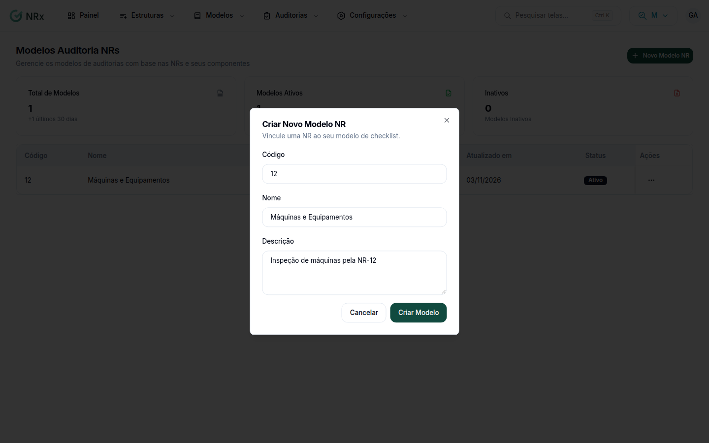
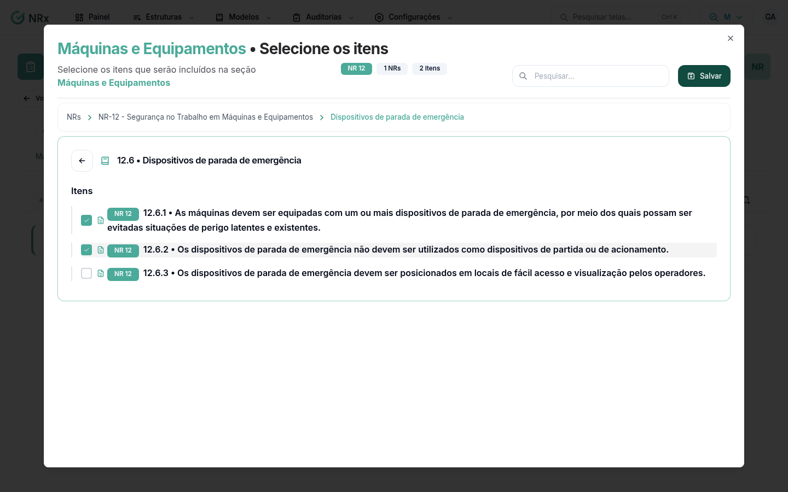

# Criar um modelo NR

**Para que serve:** montar um checklist com itens tirados das Normas Regulamentadoras. Ex.: inspeção de máquinas pela NR-12.


**Quem pode fazer:** Gestor ou Administrador, com as permissões de criar e de editar modelos.


## Passo a passo



### Abra o novo modelo

Clique em **Modelos NRs** e em **Novo Modelo NR**.

<figure><figcaption>
Criar Novo Modelo NR
</figcaption></figure>



### Preencha e crie

Informe o **Código**, o **Nome** e, se quiser, a **Descrição**. Clique em **Criar Modelo**. Aparece "Modelo NR criado com sucesso."



### Crie uma seção

Clique no nome do modelo para abri-lo. Clique em **Nova Seção**, informe **Nome**, **Código**, **Ordem** e, se quiser, a **Descrição**, e clique em **Criar Seção**.



### Inclua os itens da NR

Clique em **Selecionar Items NR da seção**. Navegue pelas NRs e marque os itens. Clique em **Salvar**, revise e clique em **Confirmar**.

<figure><figcaption>
Selecionar os itens da NR
</figcaption></figure>



## Deu errado?


**"Código é obrigatório"**: informe o código.



**"Nome é obrigatório"**: informe o nome.


## Dúvidas comuns

Como tiro um item ou uma seção?

Use o ícone de lixeira do item ou da seção e confirme em **Confirmar Desvinculação**. O histórico das auditorias já feitas é mantido.

Como mudo o nome ou o código?

Em **Modelos NRs**, abra o menu da linha e clique em **Editar**.

Dá para levar o modelo para o Excel?

Sim. Dentro do modelo, clique em **Exportar Excel** e escolha **Planilha de Preenchimento** (para preencher fora do sistema) ou **Estrutura Detalhada** (seções, itens e alíneas).

Como inativo o modelo?

No menu da linha, clique em **Inativar**. Pede a permissão de excluir modelos.

