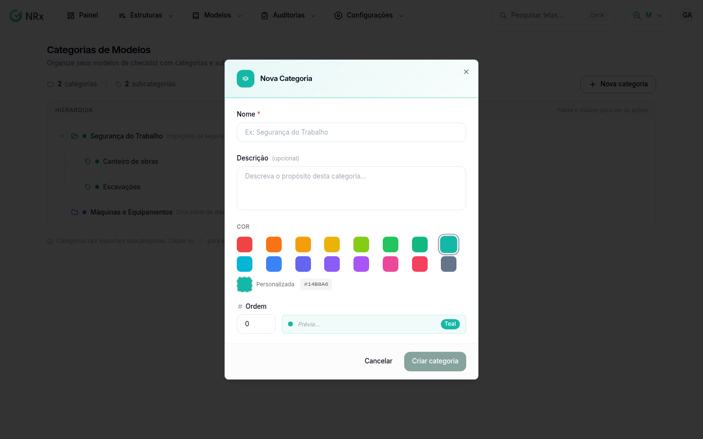

# Organizar os modelos em categorias

**Para que serve:** agrupar os modelos para achar mais rápido e filtrar o painel. Ex.: "Segurança do Trabalho" › "Máquinas".


**Quem pode fazer:** todas as roles.


## Passo a passo



### Crie a categoria

Clique em **Categorias de Modelos** e em **Nova categoria**.

<figure><figcaption>
Categorias de Modelos
</figcaption></figure>



### Preencha

Informe o **Nome** e, se quiser, a descrição. Escolha a **Cor** e a **Ordem**. Clique em **Criar categoria**.



### Crie subcategorias

Passe o mouse na categoria e clique em **Nova subcategoria**.



### Associe os modelos

Em **Modelos Customizados**, abra o menu da linha e clique em **Associar categoria**. Marque as categorias e clique em **Salvar**.



## Deu errado?


**"Erro ao criar categoria."**: tente de novo.


## Dúvidas comuns

Para que serve "Categoria ativa"?

Categoria inativa não aparece na hora de escolher a categoria de um modelo.

Como excluo uma categoria?

Passe o mouse e clique em **Excluir**. As subcategorias dela também são excluídas, e não dá para desfazer.

Onde uso a categoria?

No filtro **Categoria** de **Modelos Customizados** e no filtro de categorias do [painel](../painel.md).

