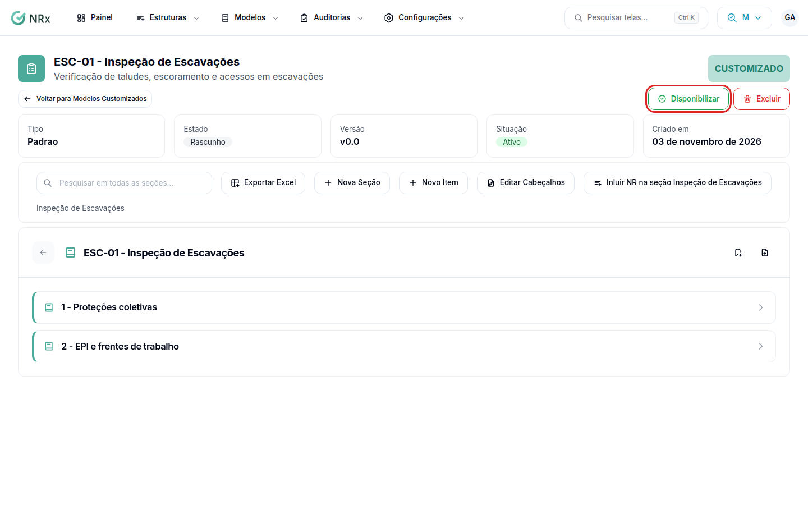

# Disponibilizar, revisar ou inativar um modelo

**Para que serve:** liberar um modelo customizado para as auditorias e, depois, alterar ou tirar de uso.


**Quem pode fazer:** Gestor ou Administrador, com a permissão de editar modelos. Criar uma nova versão pede a permissão de criar modelos. Inativar pede a permissão de excluir modelos.


## Antes de começar

* Tenha um [modelo customizado](../modelo-customizado.md) criado.

## Os estados do modelo

| Estado | O que significa |
| --- | --- |
| **Rascunho** | Em montagem. Ainda não vai para as auditorias. |
| **Disponível** | Liberado para as auditorias. Não dá para editar. |
| **Em Edição** | Sendo alterado depois de disponível. |

## Passo a passo



### Abra o modelo

Clique em **Modelos Customizados** e no nome do modelo.

<figure><figcaption>
Modelo aberto
</figcaption></figure>



### Disponibilize

Clique em **Disponibilizar** e em **Confirmar**. O modelo fica **Disponível**.



### Para alterar

Clique em **Colocar em Edição** e em **Confirmar**. Faça as mudanças e clique em **Disponibilizar** de novo.



## Dúvidas comuns

Como crio uma nova versão sem mexer na atual?

Em **Modelos Customizados**, abra o menu da linha de um modelo **Disponível** e clique em **Clonar Modelo** e em **Confirmar e Clonar**. Depois clique em **Abrir Modelo**.

Como tiro o modelo de uso?

Dentro do modelo, clique em **Excluir** e em **Inativar**. Ou use **Inativar** no menu da linha. O modelo vai para **Inativos**.

Como levo o modelo para o Excel?

Dentro do modelo, clique em **Exportar Excel** e escolha **Planilha de Preenchimento** ou **Estrutura Detalhada**.

