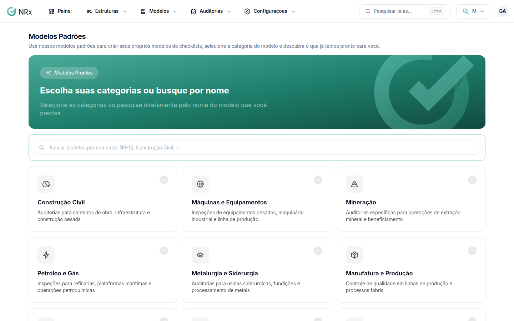

# Usar um modelo pronto

**Para que serve:** começar de um checklist pronto do GNRx em vez de montar do zero. Ex.: NR-12 ou construção civil.


**Quem pode fazer:** Gestor ou Administrador, com a permissão de criar modelos.


## Passo a passo



### Escolha as categorias

Clique em **Modelos Padrões**. Marque as categorias ou busque pelo nome, e clique em **Ver modelos disponíveis**.

<figure><figcaption>
Modelos Prontos
</figcaption></figure>



### Veja o modelo

No modelo que quiser, clique em **Ver detalhes** e confira as seções e os itens.



### Copie

Clique em **Utilizar Modelo** e em **Confirmar e Clonar**. Aparece "Modelo Clonado com Sucesso!".



### Abra a cópia

Clique em **Abrir Modelo** para ajustar a cópia, ou em **Adicionar Mais Modelos** para copiar outro.



## Dúvidas comuns

Onde fica a cópia?

Em **Modelos Customizados**. Ela é da sua empresa e pode ser alterada à vontade.

A cópia já pode ser usada nas auditorias?

Confira o **Estado** na lista. Se não estiver **Disponível**, veja [Disponibilizar, revisar ou inativar um modelo](disponibilizar-modelo.md).

