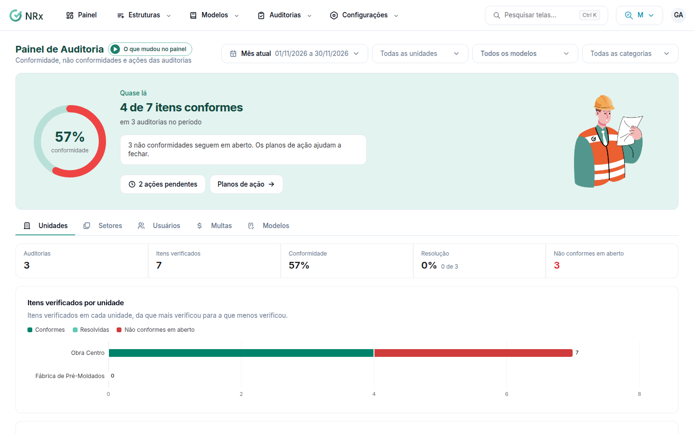

# Ver o painel de auditorias

**Para que serve:** ver de relance a conformidade das auditorias, o que está em aberto e onde agir. Ex.: descobrir qual unidade tem mais não conformidades no mês.


**Quem pode fazer:** Supervisor, Gestor ou Administrador, com a permissão de ver o painel de auditorias.


## Antes de começar

* Tenha auditorias feitas no período. Veja [Criar uma auditoria](criar-auditoria.md).

## Passo a passo



### Abra o painel

Clique em **Painel de Auditorias**. Na primeira vez abre um tour com o que mudou: clique em **Ver o painel** ou em **Agora não**.

<figure><figcaption>
Painel de Auditoria
</figcaption></figure>



### Ajuste os filtros

Escolha o período (vem no mês atual), as unidades, o modelo e a categoria. Os filtros valem para o painel inteiro. **Limpar** volta ao padrão.



### Leia o resumo

O topo mostra o percentual de conformidade e quantos itens foram conformes. Se houver ação atrasada ou pendente, use os atalhos para abrir as ações em **Planos de Ação**.



### Escolha a aba

| Aba | O que mostra |
| --- | --- |
| **Unidades** | Itens conformes, resolvidos e em aberto de cada unidade. |
| **Setores** | Os setores dentro de cada unidade, os que pedem mais atenção primeiro. |
| **Usuários** | Volume, qualidade e tempo de cada auditor. |
| **Multas** | A exposição a multas em aberto e a multa já evitada. |
| **Modelos** | Os modelos com mais não conformidades e os itens que mais falham. |



## Deu errado?


**"Não foi possível carregar o dashboard"**: clique em **Tentar novamente**.


## Dúvidas comuns

Aparece "Nenhuma auditoria no período"?

Não há auditoria no período ou nos filtros escolhidos. Aumente o período ou clique em **Limpar**.

Por que o filtro de unidades está travado?

Você só tem uma unidade vinculada. O painel mostra apenas as unidades vinculadas ao seu usuário.

Como a multa é calculada?

Multa unitária × ocorrências. A multa unitária vem do valor informado no item ou, sem ele, do máximo da NR-28.

O que é a linha "Sem setor"?

As auditorias criadas sem setor. Elas entram na conta para o painel bater com os relatórios.

