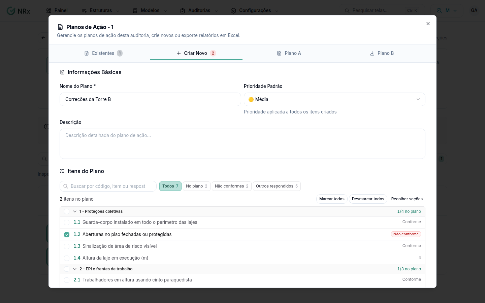

# Criar um plano de ação a partir da auditoria

**Para que serve:** transformar as não conformidades da auditoria em ações com responsável e prazo, para acompanhar até concluir.


**Quem pode fazer:** todas as roles, com a permissão de criar planos de ação.


## Antes de começar

* A auditoria precisa estar **Finalizada**, com pelo menos um item respondido. Veja [Preencher uma auditoria](../preencher-auditoria.md).

## Passo a passo



### Abra os planos da auditoria

Abra a auditoria e clique em **Planos de Ação**. Clique na aba **Criar Novo** ou em **Criar Primeiro Plano**.

<figure><figcaption>
Criar Novo plano
</figcaption></figure>



### Preencha

Informe o **Nome do Plano** e, se quiser, a **Prioridade Padrão** e a **Descrição**.



### Escolha os itens

Em **Itens do Plano**, marque os itens. Os filtros **Não conformes** e **Marcados pelo auditor** ajudam a achar.



### Defina os prazos

Em **Cronograma**, escolha a **Data de Início**, o **Prazo Final** e o **Prazo Padrão dos Itens**.



### Crie

Clique em **Criar Plano**. Aparece a mensagem com o código do plano e o total de itens.



## Deu errado?


**"Nome é obrigatório"**: informe o nome do plano.



**"Não é possível criar plano de ação"**: finalize a auditoria e responda pelo menos um item.


## Dúvidas comuns

E agora?

Atribua responsável e prazo a cada ação e acompanhe. Veja [Acompanhar um plano de ação](acompanhar-plano.md).

Onde vejo todos os planos?

Em **Planos de Ação**, no menu. A aba **Ações** junta as ações de todos os planos, com o filtro **Só atrasadas** e o Excel.

