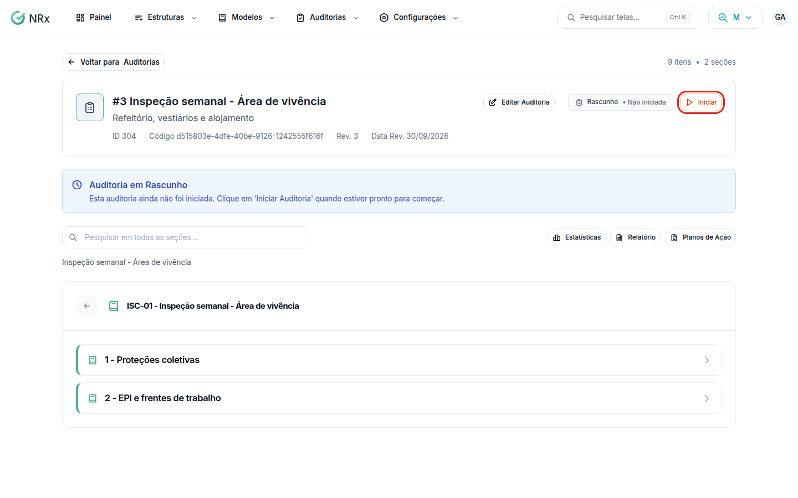
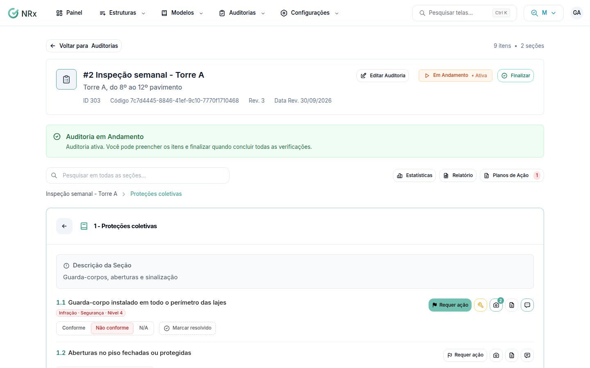

# Preencher uma auditoria

**Para que serve:** responder os itens da auditoria, registrar as evidências e finalizar.


**Quem pode fazer:** todas as roles, com as permissões de editar e de finalizar auditorias.


## Antes de começar

* [Crie a auditoria](criar-auditoria.md).

## Passo a passo



### Inicie

Abra a auditoria e clique em **Iniciar**. Ela passa para **Em Andamento**.

<figure><figcaption>
Auditoria aberta
</figcaption></figure>



### Responda os itens

Em itens de conformidade, clique em **Conforme**, **Não conforme** ou **N/A**. Nos outros tipos, clique em **Editar**, preencha e clique em **Salvar**. Cada resposta é salva na hora.



### Registre as evidências

No item, use os ícones: chave para a ação corretiva (**Salvar Ação Corretiva**), câmera para fotos, folha para documentos e balão para observações (**Salvar**).

<figure><figcaption>
Evidências do item
</figcaption></figure>



### Marque o que já foi resolvido

Se a não conformidade foi corrigida na hora, clique em **Marcar resolvido**. Para mandar o item ao plano de ação, clique em **Requer ação**.



### Finalize

Clique em **Finalizar**. A auditoria fica **Finalizada** e bloqueada para edição.



## Deu errado?

| Mensagem na tela | O que fazer |
| --- | --- |
| "Arquivo muito grande. Máximo: 10MB" | Envie uma foto menor. |
| "Formato não permitido." | Envie um arquivo num dos formatos aceitos. |
| "Digite um código válido." | Confira o código de barras digitado. |
| "Geolocalização não suportada pelo navegador." | Digite a latitude e a longitude, ou use o aplicativo. |

## Dúvidas comuns

Como reabro uma auditoria finalizada?

Clique em **Reabrir**. Ela volta para **Em Andamento**.

Como corrijo a unidade, o setor ou a data?

Na auditoria, clique em **Editar Auditoria**. Ajuste o nome, a descrição, a unidade, o setor ou a data e clique em **Salvar**.

Errei a resposta de conformidade?

Clique de novo na resposta marcada para limpar.

Pelo celular?

Também dá, até sem internet. Veja o [aplicativo](../aplicativo/preencher-auditoria.md).

