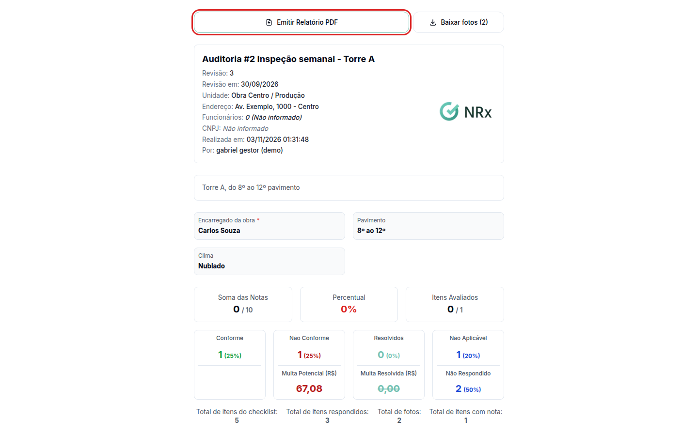
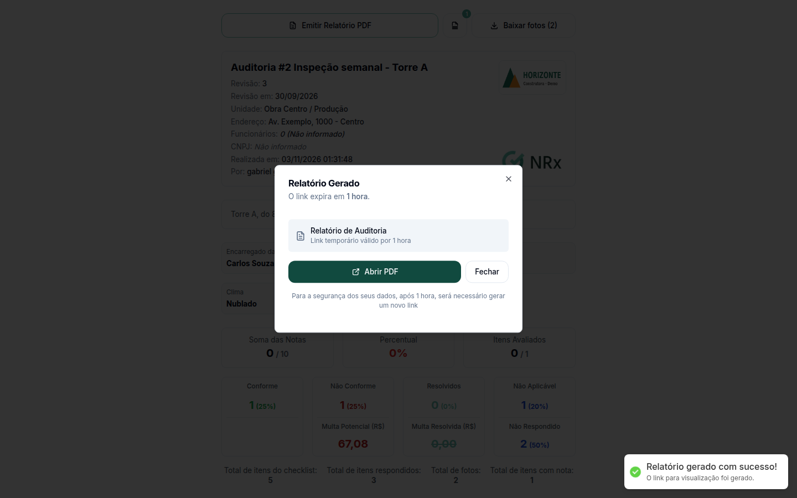

# Emitir o relatório da auditoria

**Para que serve:** gerar o PDF da auditoria para enviar ou arquivar, e baixar as fotos e os documentos anexados.


**Quem pode fazer:** todas as roles, com a permissão de exportar relatórios de auditoria.


## Antes de começar

* [Preencha a auditoria](preencher-auditoria.md).

## Passo a passo



### Abra o relatório

Abra a auditoria e clique em **Relatório**.

<figure><figcaption>
Relatório da auditoria
</figcaption></figure>



### Configure

Clique em **Emitir Relatório PDF**. Em **Exibição**, marque **Data e hora dos itens** se quiser mostrar quando cada item foi respondido. Clique em **Gerar PDF**.



### Aguarde

Não feche a janela até o PDF ficar pronto.



### Abra o PDF

Clique em **Abrir PDF**. O link vale por 1 hora.

<figure><figcaption>
Relatório Gerado
</figcaption></figure>



## Deu errado?


**"Não foi possível gerar o relatório."**: clique em **Tentar novamente**.



**"Não foi possível iniciar a geração. Tente novamente."**: clique em **Emitir Relatório PDF** de novo.


## Dúvidas comuns

O link expirou?

Gere o PDF de novo. Por segurança, os links valem 1 hora. Os gerados aparecem em **Relatórios gerados**.

Como baixo todas as fotos?

Na página do relatório, clique em **Baixar fotos**. Para os anexos, clique em **Baixar documentos**.

