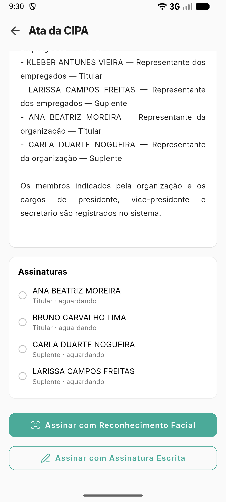

# Assinar a ata pelo aplicativo

**Para que serve:** assinar a ata da CIPA pelo celular, quando você é signatário.


**Quem pode fazer:** o membro ou signatário da ata, no **aplicativo GNRx Colaborador**.


## Antes de começar

* Tenha o aplicativo GNRx Colaborador no celular.

## Passo a passo



### Abra a ata

No aplicativo, abra a aba **CIPA**. Em **Atas para assinar**, toque na ata. Aparece "Sua assinatura é necessária".

<figure><figcaption>
Ata da CIPA
</figcaption></figure>



### Assine

Toque em **Assinar com Reconhecimento Facial** ou **Assinar com Assinatura Escrita**. Aparece "Assinatura registrada", com quantas faltam.



## Deu errado?


**"Não foi possível assinar a ata."**: confira a internet e toque em **Tentar de novo**.


## Dúvidas comuns

Como sei quem já assinou?

Em **Assinaturas**, cada um aparece com a data e a hora em que assinou.

Onde vejo as atas antigas?

Na aba **CIPA**, em **Atas publicadas**.

