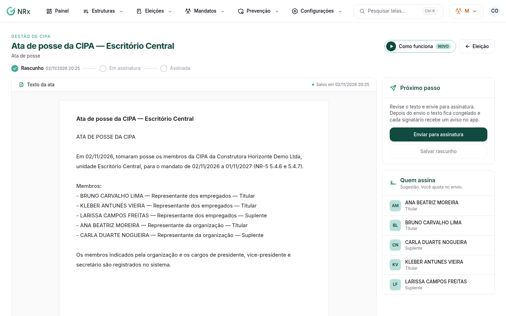

# Assinar uma ata

**Para que serve:** escrever a ata, colher as assinaturas e publicar no mural do app. A ata assinada fica imutável e tem código de autenticidade.


**Quem pode fazer:** para escrever, enviar, colher a assinatura no painel e publicar: Supervisor, Gestor ou Administrador, com a permissão de gerenciar reuniões, presença e atas. Para ver e baixar o PDF: a permissão de ver mandatos. Os membros também assinam pelo aplicativo.


## Antes de começar

* A ata de eleição nasce na apuração, a de posse na posse e a de reunião quando a reunião é realizada.

## Passo a passo



### Escreva o texto

Clique em **Mandatos › Atas** e abra a ata. Em **Texto da ata**, ajuste o **Título** e o **Conteúdo**. Clique em **Salvar rascunho**.

<figure><figcaption>
Ata
</figcaption></figure>



### Envie para assinatura

Clique em **Enviar para assinatura**. Na janela **Quem assina**, confira os signatários sugeridos e inclua os que faltam. Clique em **Congelar texto e enviar**. Aparece "Ata enviada para assinatura. O texto agora está congelado.".



### Colha as assinaturas

Os signatários assinam pelo aplicativo (veja [Assinar a ata pelo aplicativo](assinar-ata-pelo-app.md)). Para quem está com você, use **Colher assinatura aqui**. Quando todas as obrigatórias forem colhidas, aparece "Ata assinada por todos. O PDF foi gerado.".



### Publique

Clique em **Publicar no mural**. Aparece "Ata publicada no mural do app.".



## Dúvidas comuns

Posso mudar o texto depois de enviar?

Não. O texto fica congelado ao enviar para assinatura.

Onde baixo a ata?

Clique em **Abrir PDF**.

