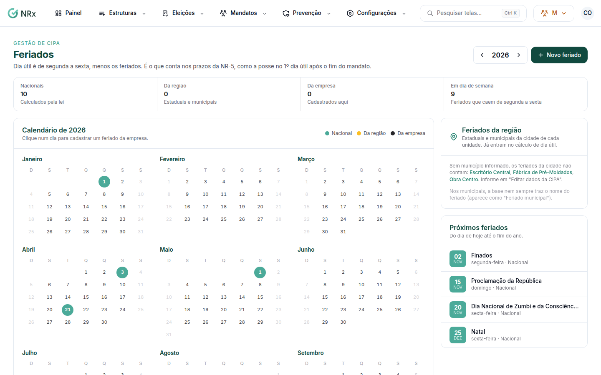

# Cadastrar os feriados

**Para que serve:** cadastrar os feriados da empresa, para os prazos da NR-5 contarem só dias úteis.


**Quem pode fazer:** para abrir, quem tem a permissão de ver as unidades da CIPA. Para salvar: Gestor ou Administrador, com a permissão de editar os dados da CIPA da unidade e os feriados.


## Antes de começar

* Os feriados nacionais, estaduais e municipais da cidade de cada unidade já entram sozinhos.

## Passo a passo



### Abra os feriados

Clique em **Configurações › Feriados**. O calendário mostra os **Feriados da região** e os **Cadastrados aqui**.

<figure><figcaption>
Feriados
</figcaption></figure>



### Cadastre

Clique num dia ou em **Novo feriado**. Informe a **Data**, o **Nome** (ex.: Aniversário da cidade) e para que unidades vale (**Todas as unidades** ou algumas). Se for todo ano, ligue **Repete todo ano**. Clique em **Cadastrar**. Aparece "Feriado cadastrado.".



## Dúvidas comuns

O que é dia útil para a NR-5?

De segunda a sexta, menos os feriados. É o que conta nos prazos, como a posse no 1º dia útil.

Como tiro um feriado?

Remova o feriado. Aparece "Feriado removido.".

