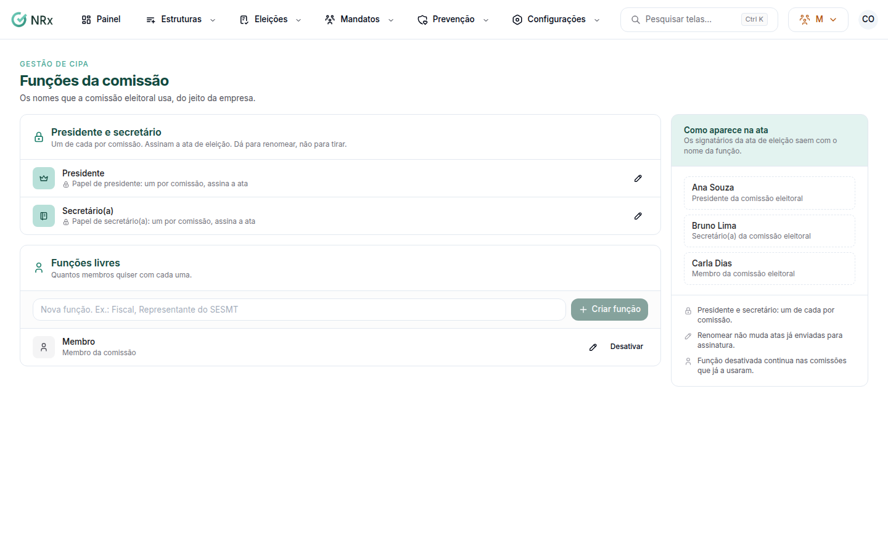

# Ajustar as funções da comissão

**Para que serve:** dar às funções da comissão eleitoral os nomes que a empresa usa. Elas aparecem na ata.


**Quem pode fazer:** Gestor ou Administrador, com a permissão de editar as configurações da CIPA da empresa.


## Antes de começar

* **Presidente e secretário** existem em toda comissão e assinam a ata de eleição. Dá para renomear, não para tirar.

## Passo a passo



### Abra as funções

Clique em **Configurações › Funções da comissão**.

<figure><figcaption>
Funções da comissão
</figcaption></figure>



### Crie ou renomeie

Em **Funções livres**, escreva o **Nome da nova função** (ex.: Fiscal, Representante do SESMT) e clique em **Criar função**. Para mudar um nome, edite e clique em **Salvar nome**. Veja **Como aparece na ata**.



## Dúvidas comuns

Quantos membros podem ter a mesma função livre?

Quantos quiser.

Desativei uma função usada.

Ela continua nas comissões que já a usaram. Para trazer de volta, clique em **Reativar**.

