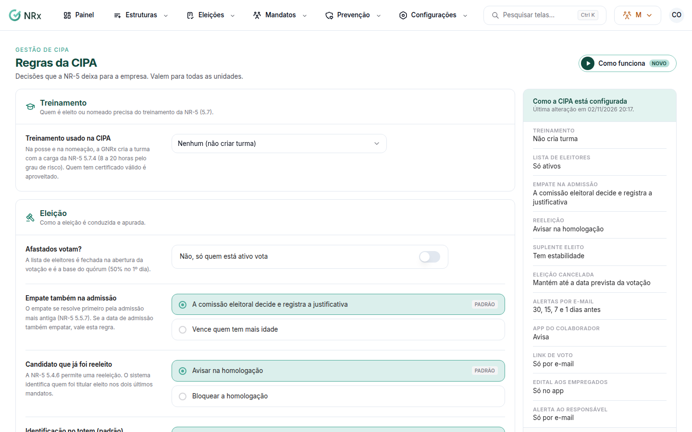

# Ajustar as regras da CIPA

**Para que serve:** definir as decisões que a NR-5 deixa para a empresa: eleição, apuração, avisos e treinamento. Valem para todas as unidades.


**Quem pode fazer:** para abrir, quem tem a permissão de ver as unidades da CIPA. Para salvar: Gestor ou Administrador, com a permissão de editar as configurações da CIPA da empresa.


## Antes de começar

* As regras valem para os próximos processos e alertas.

## Passo a passo



### Abra as regras

Clique em **Configurações › Regras da CIPA**.

<figure><figcaption>
Regras da CIPA
</figcaption></figure>



### Eleição e apuração

Escolha a **Lista de eleitores** (**Ativos e afastados** ou **Só ativos**). Ela é fechada na abertura da votação e é a base do quórum (50% no 1º dia). Defina o **Empate na admissão** e se o **Suplente eleito** tem estabilidade.



### Avisos

Escolha como sai o **Link de voto** (**E-mail e WhatsApp** ou **Só por e-mail**), o **Edital aos empregados** (**App e WhatsApp** ou **Só no app**) e o **Alerta ao responsável**.



### Treinamento

Em **Treinamento usado na CIPA**, escolha o treinamento (ou **Nenhum (não criar turma)**). Com o módulo de Treinamentos, a turma é criada sozinha na posse, com a carga da NR-5 5.7.4. Clique em **Salvar regras**. Aparece "Regras salvas.".



## Dúvidas comuns

Não tenho o módulo de Treinamentos.

Aparece "Módulo de Treinamentos não contratado.". O prazo do treinamento é acompanhado pelos alertas.

Mudei algo e não quero salvar.

Clique em **Descartar alterações**.

