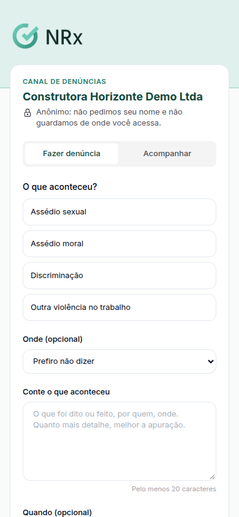
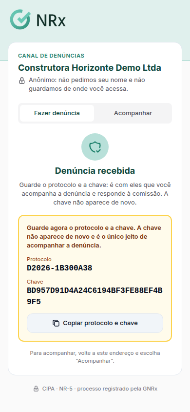

# Fazer uma denúncia

**Para que serve:** contar uma situação de assédio ou violência no trabalho, com segurança. Se escolher anônimo, ninguém fica sabendo quem denunciou, nem a comissão.


**Quem pode fazer:** qualquer pessoa, pelo link do canal de denúncias da empresa, ou o colaborador, pelo aplicativo GNRx Colaborador.


## Antes de começar

* Tenha o link do canal (a empresa divulga no cartaz) ou o aplicativo.

## Passo a passo



### Abra o canal

Abra o link do canal ou, no aplicativo, a aba **CIPA** › **Canal de denúncias**. Toque em **Fazer denúncia**.

<figure><figcaption>
Canal de denúncias
</figcaption></figure>



### Conte o que aconteceu

Escolha anônima ou identificada. Em **O que aconteceu?**, escolha **Assédio sexual**, **Assédio moral** ou **Outra violência no trabalho**. Em **Conte o que aconteceu**, escreva o que foi dito ou feito, por quem e onde. Só o relato é obrigatório.



### Envie e guarde o protocolo

Toque em **Enviar denúncia**. Aparecem o **Protocolo** e a **Chave**. Guarde os dois: a chave aparece uma vez só. Use **Copiar protocolo e chave**.

<figure><figcaption>
Denúncia recebida
</figcaption></figure>



## Deu errado?

| Mensagem na tela | O que fazer |
| --- | --- |
| "Canal não encontrado. Confira o endereço com a sua empresa." | Confira o link. |
| "Não foi possível enviar a denúncia." | Confira a internet e envie de novo. |
| "Protocolo ou chave não conferem." | Digite o protocolo e a chave de novo, com calma. |

## Dúvidas comuns

Como acompanho a minha denúncia?

Use **Ver andamento** (ou **Acompanhar** no app), com o protocolo e a chave. Você vê a situação, as respostas da comissão e pode usar **Responder à comissão**.

Perdi a chave.

A chave aparece uma vez só e o app não guarda. Sem ela, não dá para acompanhar a denúncia anônima. Você pode fazer uma nova.

