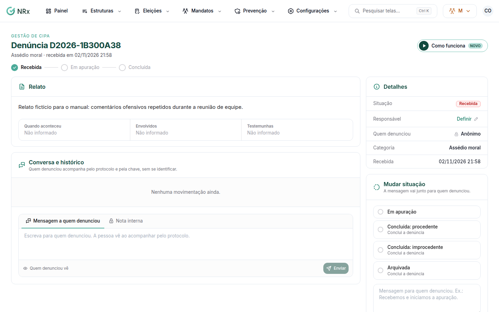

# Tratar uma denúncia

**Para que serve:** receber, apurar e responder as denúncias de assédio e violência no trabalho.


**Dado sensível.** Entre as roles padrão, só o **Administrador** acessa as denúncias. O acesso Empresa (CNPJ) também vê, e uma role própria com a permissão de receber e apurar denúncias também. O relato só aparece dentro de cada denúncia, e toda ação fica registrada.


## Antes de começar

* As denúncias chegam pelo app e pelo link público. O link fica em **Prevenção ao assédio**.

## Passo a passo



### Abra a denúncia

Clique em **Prevenção › Denúncias** e abra a denúncia. Veja a **Categoria**, a **Unidade**, **Quando aconteceu** e o relato. No topo, a denúncia passa por **Recebida › Em apuração › Concluída**.

<figure><figcaption>
Denúncia
</figcaption></figure>



### Defina o responsável

Em **Responsável**, clique em **Definir**. Aparece "Responsável atualizado.".



### Converse e registre

Em **Conversa e histórico**, use **Mensagem a quem denunciou** (a pessoa vê ao acompanhar pelo protocolo) ou **Nota interna** (só a comissão vê).



### Atualize a situação

Clique em **Atualizar situação** e escolha a nova situação: **Em apuração**, **Concluída: procedente**, **Concluída: improcedente** ou **Arquivada**. Se quiser, escreva uma mensagem (ex.: Recebemos e iniciamos a apuração). Aparece "Situação atualizada.".



## Dúvidas comuns

Como sei quem denunciou?

Na denúncia anônima, não há como saber. Quem denunciou acompanha pelo protocolo e pela chave, sem se identificar.

A pessoa vê as notas internas?

Não. Só a comissão vê.

