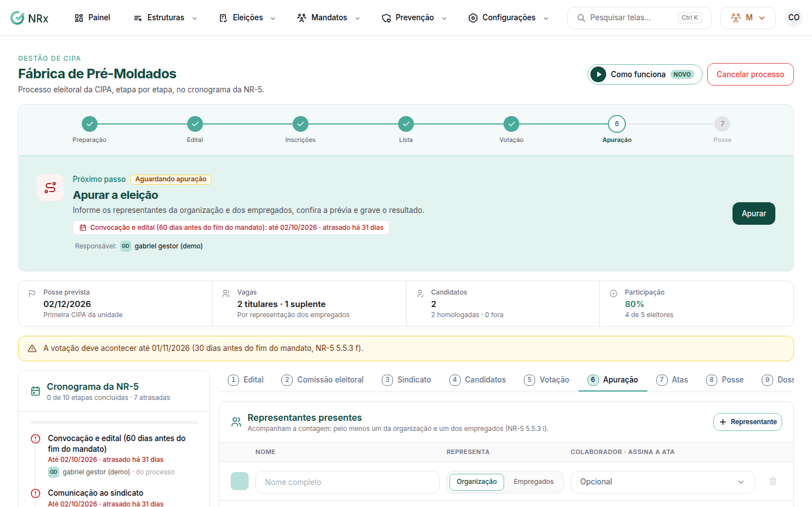

# Apurar a eleição

**Para que serve:** contar os votos com os representantes, decidir os empates e gravar o resultado. Os eleitos passam a ter estabilidade até um ano após o fim do mandato.


**Quem pode fazer:** Gestor ou Administrador, com a permissão de apurar a eleição e dar posse.


## Antes de começar

* A votação precisa estar encerrada, com o quórum atingido.
* Pelo menos um representante da organização e um dos empregados acompanham a contagem (NR-5 5.5.3 i).

## Passo a passo



### Registre os representantes

Abra a eleição e vá à aba **Apuração**. Em **Representantes presentes**, informe o **Nome completo** e quem cada um representa.

<figure><figcaption>
Aba Apuração
</figcaption></figure>



### Confira a prévia

Veja a **Prévia do resultado**: é uma simulação com os votos atuais. Nada é gravado até você apurar. Empates se resolvem pela admissão mais antiga.



### Decida os empates (se houver)

Em **Desempates da comissão**, escreva a **Justificativa da decisão** (ex.: sorteio na presença dos representantes).



### Apure

Clique em **Apurar e gravar o resultado** e confirme. Aparece "Apuração concluída. O rascunho da ata de eleição foi criado.".




O resultado fica gravado com código de autenticidade e não muda mais.


## Dúvidas comuns

Um candidato está sem data de admissão.

Complete a admissão no cadastro do colaborador. Ela decide os empates.

E depois de apurar?

Abra a **Ata de eleição**, colha as assinaturas e dê posse, em **Assinar a ata e dar posse**.

