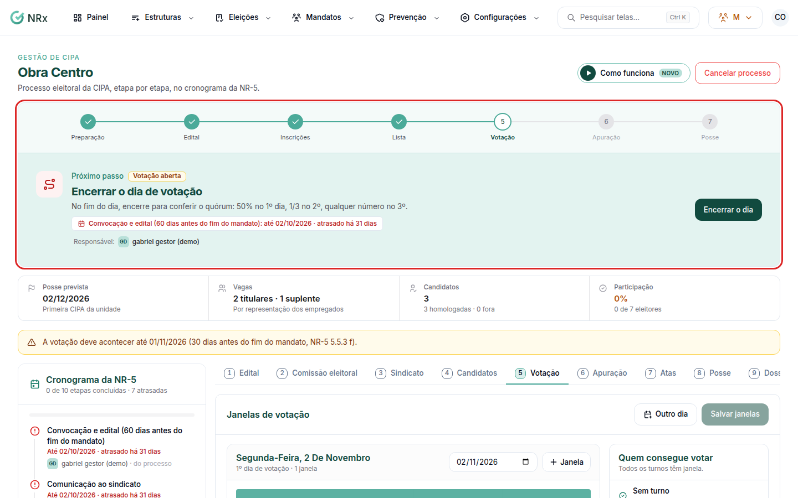

# Conduzir a eleição

**Para que serve:** seguir as etapas da eleição, do edital à posse, sem perder prazo.


**Quem pode fazer:** Supervisor, Gestor ou Administrador, com a permissão de conduzir o processo eleitoral. Para apurar e dar posse: Gestor ou Administrador, com a permissão de apurar a eleição.


## Antes de começar

* [Abra a eleição](nova-eleicao.md).

## Passo a passo



### Publique o edital

Clique em **Eleições › Processos eleitorais** e abra a eleição. Clique em **Publicar o edital** e confirme.

<figure><figcaption>
Condução da eleição
</figcaption></figure>



### Inscrições

Clique em **Comunicar o sindicato e abrir as inscrições**. O sindicato recebe a comunicação por e-mail. As inscrições ficam na aba **Candidatos**. No fim do prazo, clique em **Encerrar as inscrições** e depois em **Decidir as inscrições e publicar a lista**.



### Votação

Clique em **Definir as janelas e abrir a votação**. Os colaboradores votam pelo link, pelo totem ou pelo aplicativo. Veja [Votar na eleição da CIPA](votar.md) e [Montar o totem de votação](montar-totem.md). A aba **Votação** acompanha a participação. Ao fim do dia, clique em **Encerrar o dia de votação** (ou **Reabrir a votação**, se preciso).



### Apure e dê posse

Clique em **Apurar a eleição** (veja [Apurar a eleição](apurar-eleicao.md)). Depois, em **Assinar a ata e dar posse**, na aba de posse.



## Dúvidas comuns

O sindicato confirma o recebimento?

Sim. Ele abre a comunicação pelo e-mail e clica em **Confirmo o recebimento**. No fim, recebe o **Dossiê do processo eleitoral**, em PDF com código de autenticidade.

Preciso cancelar o processo.

Gestor e Administrador, com a permissão de cancelar processo eleitoral, podem cancelar.

