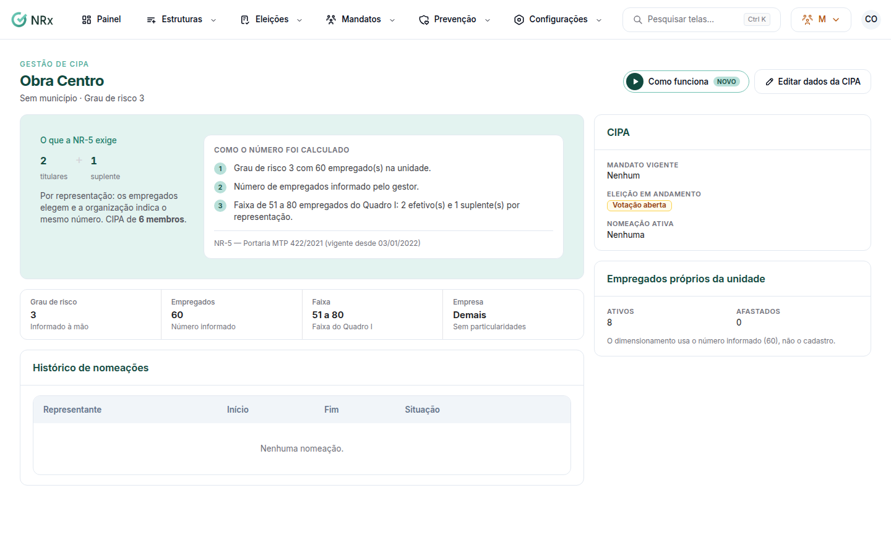

# Dimensionar a CIPA da unidade

**Para que serve:** configurar a unidade para a CIPA e ver quantos membros ela precisa, pelo Quadro I da NR-5.


**Quem pode fazer:** Gestor ou Administrador, com a permissão de editar os dados da CIPA da unidade. Para nomear o representante: a permissão de nomear o representante da NR-5.


## Antes de começar

* Tenha a classe CNAE ou o grau de risco da atividade da unidade.

## Passo a passo



### Abra a unidade

Clique em **Eleições › Unidades e dimensionamento** e abra a unidade. Se aparecer "Falta configurar esta unidade para a CIPA", clique em **Configurar**.

<figure><figcaption>
Ficha da unidade
</figcaption></figure>



### Informe a atividade

Em **Editar dados da CIPA**, informe a classe CNAE ou o **Grau de risco**. Com o número de empregados da unidade, o sistema calcula pelo Quadro I. Veja **Como o número foi calculado** e **O que a NR-5 exige**.



### Siga o que a NR-5 exige

* Unidade obrigada a ter CIPA: clique em **Iniciar eleição**.
* Abaixo do mínimo do Quadro I: a empresa nomeia um representante por 1 ano (NR-5 5.4.13). Clique em **Nomear representante**, escolha o **Empregado** e clique em **Nomear**.



## Dúvidas comuns

A nomeação vale por quanto tempo?

1 ano. Ela substitui a ativa. Para encerrar antes, clique em **Encerrar nomeação**.

Apareceu "Sem obrigação de CIPA nem de representante".

Pelo Quadro I, a unidade não precisa de CIPA nem de representante.

