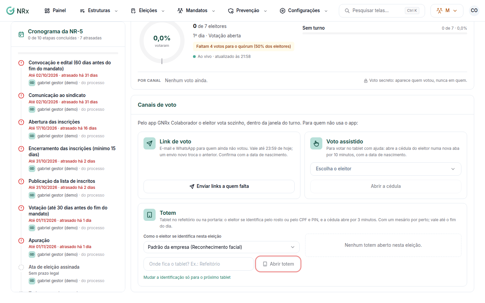

# Montar o totem de votação

**Para que serve:** deixar um tablet no refeitório ou na portaria para os eleitores votarem. O eleitor se identifica pelo rosto ou pelo CPF e PIN, e a cédula abre por 3 minutos.


**Quem pode fazer:** Supervisor, Gestor ou Administrador, com a permissão de conduzir o processo eleitoral.


## Antes de começar

* A votação precisa estar aberta ([Conduzir a eleição](conduzir-eleicao.md)).
* Tenha um tablet com câmera e internet, e um mesário por perto.

## Passo a passo



### Escolha a identificação

Abra a eleição e vá à aba **Totens**. Em **Como o eleitor se identifica nesta eleição**, escolha o modo (rosto, CPF e PIN, ou os dois). Aparece "Identificação do totem atualizada para esta eleição.".

<figure><figcaption>
Aba Totens
</figcaption></figure>



### Abra o totem

Diga onde fica o tablet (ex.: Refeitório) e clique em **Abrir totem**. Se quiser outra identificação só nesse tablet, use **Mudar a identificação só para o próximo tablet**.



### Leve o link para o tablet

Em **Totem aberto**, clique em **Abrir neste aparelho** (se você já está no tablet) ou em **Copiar link** e abra o link no tablet.



### Desligue no fim

Ao fim da votação, clique em **Desligar**. Aparece "Totem desligado.". O link vale até o fim do dia.



## Deu errado?

| Mensagem na tela do totem | O que fazer |
| --- | --- |
| "Este totem valia até o fim do dia. Peça à comissão eleitoral um novo link." | Abra um totem novo e leve o link. |
| "Este totem foi desligado pela comissão eleitoral." | Abra um totem novo, se a votação continua. |
| "A votação não está aberta agora." | Abra a votação na condução. |
| "Não foi possível identificar. Procure o mesário." | O eleitor usa CPF e PIN, com o mesário. |

## Dúvidas comuns

Posso ter vários totens?

Pode. Abra um totem para cada tablet. A lista mostra todos os abertos.

O eleitor não sabe o PIN.

É o PIN de 6 números do aplicativo. Se não souber, ele procura o mesário.

