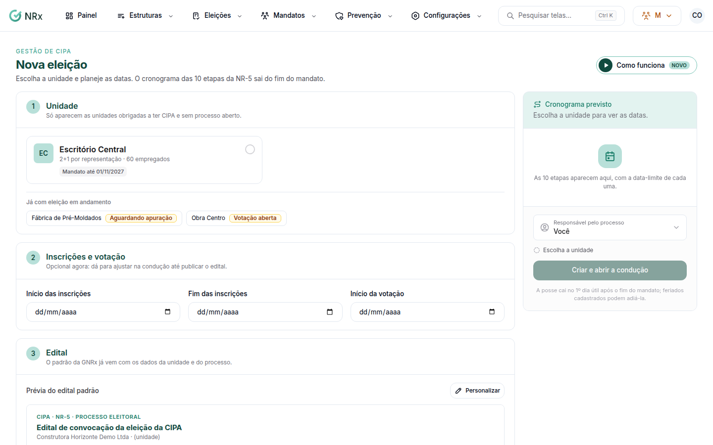

# Abrir uma eleição

**Para que serve:** abrir o processo eleitoral de uma unidade, com o cronograma das 10 etapas da NR-5.


**Quem pode fazer:** Supervisor, Gestor ou Administrador, com a permissão de conduzir o processo eleitoral.


## Antes de começar

* [Dimensione a unidade](dimensionar-unidade.md). Só aparecem as unidades obrigadas a ter CIPA e sem processo aberto.

## Passo a passo



### Escolha a unidade

Clique em **Eleições › Nova eleição** e escolha a unidade.

<figure><figcaption>
Nova eleição
</figcaption></figure>



### Planeje as datas

Informe a **Data prevista da posse**. O cronograma das 10 etapas sai do fim do mandato. Use **Usar as datas da NR-5** ou ajuste as datas de **Inscrições e votação**.



### Escolha o edital e o responsável

Use o edital padrão (já vem com os dados da unidade) ou **Edital próprio**. Em **Responsável pelo processo**, escolha quem recebe os alertas de prazo de cada etapa (ou **Eu mesmo**).



### Crie

Clique em **Criar e abrir a condução**.



## Deu errado?

| Mensagem na tela | O que fazer |
| --- | --- |
| "Escolha a unidade" | Escolha a unidade. |
| "Informe a data prevista da posse" | Informe a data. |
| **Nenhuma unidade disponível** | Todas as unidades obrigadas já têm processo aberto ou não se enquadram no Quadro I. |

## Dúvidas comuns

É a primeira CIPA da unidade.

Marque **Primeira CIPA**. Os prazos contam a partir da posse que você prevê.

Posso mudar as datas depois?

Pode, na condução, até publicar o edital.

