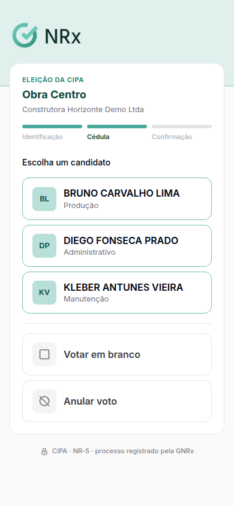
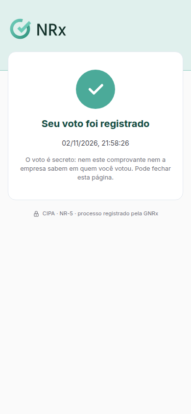

# Votar na eleição da CIPA

**Para que serve:** registrar o seu voto na eleição da CIPA. O voto é secreto: ninguém, nem a comissão, vê em quem você votou.


**Quem pode fazer:** o colaborador que está na lista de eleitores, durante a votação.


## Antes de começar

* Você vota de um destes jeitos: pelo **link** que recebeu, no **totem** da empresa ou no **aplicativo GNRx Colaborador**.

## Passo a passo



### Abra a cédula

* **Link:** abra o link e toque em **Abrir a cédula**.
* **Totem:** escolha **Usar o reconhecimento facial** e olhe para a câmera, ou **Usar CPF e PIN** e digite o CPF e o PIN (6 números).
* **Aplicativo:** na aba **CIPA**, toque em **Votar agora**.

<figure><figcaption>
Cédula
</figcaption></figure>



### Escolha

Toque no candidato. Se quiser, use **Votar em branco** ou **Anular voto**.



### Confirme

Toque em **Confirmar voto**. Depois de confirmar, não dá para mudar. No aplicativo, confirme com o rosto ou com o PIN. Aparece **Seu voto foi registrado**.

<figure><figcaption>
Voto registrado
</figcaption></figure>



## Deu errado?

| Mensagem na tela | O que fazer |
| --- | --- |
| "Este link já foi usado: o voto desta pessoa está registrado." | Você já votou. |
| "Este link expirou. Peça um novo link à comissão eleitoral." | Peça um novo link. |
| "Este link foi substituído por um mais novo. Use o último link que você recebeu." | Use o link mais novo. |
| "A votação não está aberta agora." | Vote no horário da votação. |
| **Fora do horário do seu turno** | Vote na janela do seu turno. |
| **Fora da lista de eleitores** / "Você não está na lista de eleitores desta eleição." | Procure a comissão eleitoral. |
| "Não foi possível identificar. Procure o mesário." | Use CPF e PIN ou procure o mesário. |
| "PIN incorreto. Digite de novo." | Digite o PIN do aplicativo. |
| "É preciso estar conectado para votar" | Conecte o celular à internet. |

## Dúvidas comuns

Alguém vê em quem eu votei?

Não. O sistema registra que você votou, mas não em quem.

Não sei o meu PIN.

É o PIN que você usa para entrar no aplicativo. Não sabe qual é? Procure o mesário.

