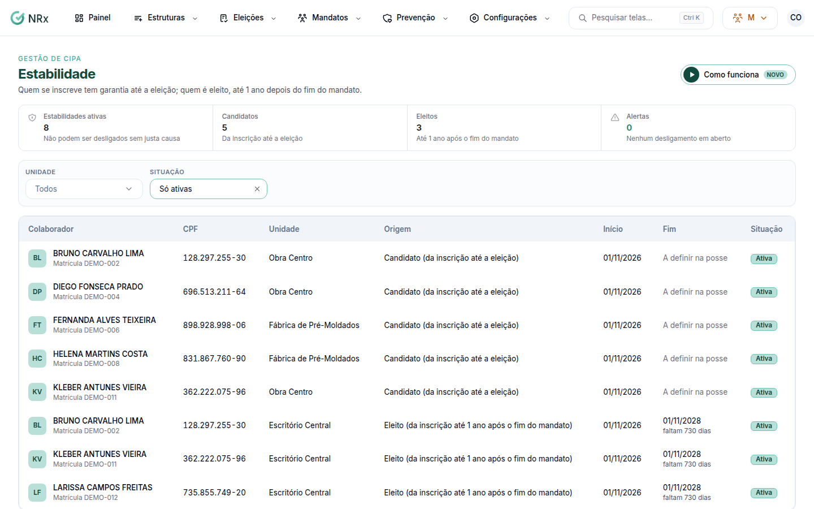

# Acompanhar a estabilidade da CIPA

**Para que serve:** ver quem tem garantia de emprego pela CIPA e conferir desligamentos. Quem se inscreve tem garantia até a eleição; quem é eleito, até 1 ano depois do fim do mandato.


**Quem pode fazer:** Supervisor, Gestor ou Administrador, com a permissão de ver a estabilidade de candidatos e eleitos.


## Antes de começar

* A garantia começa na inscrição do candidato e é estendida na posse dos eleitos.

## Passo a passo



### Abra a estabilidade

Clique em **Mandatos › Estabilidade e alertas**. Veja as **Estabilidades ativas**, com **Garantia até**.

<figure><figcaption>
Estabilidade
</figcaption></figure>



### Confira os desligamentos

Em **Desligamentos para conferir**, veja quem com garantia de emprego foi desligado. Confira se foi por justa causa ou reverta. Clique em **Resolver** e registre o que foi feito (ex.: desligamento por justa causa, desligamento revertido). Aparece "Alerta resolvido.".



## Dúvidas comuns

Por que "A definir na posse"?

A garantia do candidato vai até a eleição. A do eleito é definida na posse.

Como vejo as encerradas?

Troque **Só ativas** por **Ativas e encerradas**.

