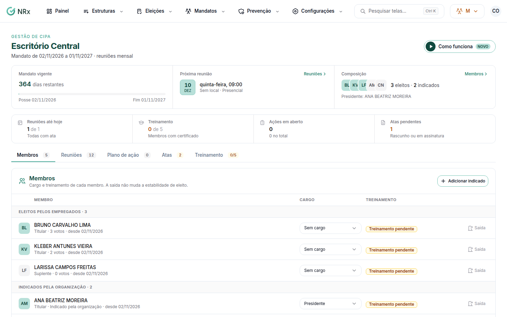

# Acompanhar o mandato

**Para que serve:** ver os membros do mandato, definir os cargos, incluir os indicados pela organização e acompanhar o treinamento da CIPA.


**Quem pode fazer:** todas as roles veem o mandato. Para mudar membros, cargos e treinamento: Gestor ou Administrador, com a permissão de gerenciar membros, cargos, calendário e treinamento da CIPA.


## Antes de começar

* O mandato nasce na posse da eleição.

## Passo a passo



### Abra o mandato

Clique em **Mandatos › Mandatos e reuniões** e abra o mandato. O topo mostra **Próxima reunião**, **Reuniões até hoje**, **Membros com certificado**, **Ações em aberto** e **Atas pendentes**.

<figure><figcaption>
Ficha do mandato
</figcaption></figure>



### Defina os membros

Na aba **Membros**, veja os **Eleitos pelos empregados** e os **Indicados pela organização**. Defina o **Cargo** de cada um. Para incluir, clique em **Adicionar indicado pela organização**.



### Cuide do treinamento

Na aba **Treinamento**, clique em **Gerar turma do treinamento** (a turma nasce no módulo de Treinamentos, ligada a este mandato) ou em **Vincular turma existente**.




A estabilidade de eleito não muda com a saída: confira com o RH antes de qualquer desligamento.


## Dúvidas comuns

Um membro saiu da comissão.

Na aba **Membros**, use **Registrar saída**.

Onde ficam a presença e o certificado do treinamento?

No módulo de Treinamentos, na turma ligada ao mandato. Use **Abrir a turma**.

